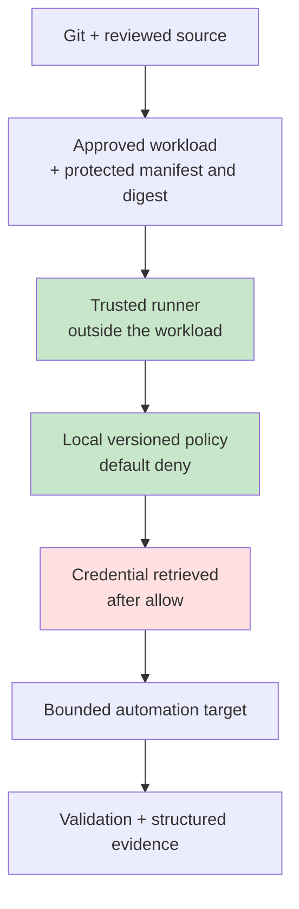

## Adoption Profiles

The [full reference architecture](./architecture.md) is the destination. Very few organisations can build it in one step, and most do not need all of it for every workload.

The profiles below keep the same trust model and the same [ten invariants](./index.md#ten-invariants), and vary how strongly each is enforced. They are graded by **risk, maturity, and the systems you already have**. "Small company" is deliberately not a profile: a small organisation running critical infrastructure may belong in High-Assurance.

Progressive adoption is not foreign to Zero Trust. CISA's [Zero Trust Maturity Model](https://www.cisa.gov/resources-tools/resources/zero-trust-maturity-model) describes maturity in stages — Traditional, Initial, Advanced, Optimal — rather than as a condition you either meet or do not. The profiles take the same view of privileged automation. They are not a mapping onto CISA's stages, and a Foundation implementation is not a claim of any particular CISA maturity level.

!!! warning "Profiles are not interchangeable"
    Every profile here implements the model. They do not implement it equally. A Foundation implementation is a real control and a real improvement on implicit trust, but presenting it as equivalent to High-Assurance is exactly the kind of claim this architecture exists to prevent.

---

## Profile A — Foundation

**Suitable when** tooling is limited and automation risk is modest, or as the first demonstrator before integrating with enterprise systems.

**Why it exists:** it proves the trust model with components a small engineering team can understand and operate. Its security leans heavily on protecting the runner host, the policy file, the expected digests, and the credentials. Anyone who can edit the policy or the digest list can approve their own workload, so treat those files with the same care as the credentials themselves.

This is the profile the [proof of concept](./proof-of-concept.md) implements.

## Profile B — Integrated

**Suitable where** enterprise identity, CI/CD, central secrets, and central logging already exist.

- CI builds and tests each release, and artefact signing is introduced
- Existing enterprise identity supplies requester context
- The central secrets platform releases credentials only after an allow decision
- Policy stays relatively simple, but is centrally managed or protected
- Logs and validation evidence are exported centrally
- The runner is hardened, and separated from developer workstations

**Why it exists:** it gains real separation and central visibility without needing a dedicated system for every target-state component.

## Profile C — Enterprise

**Suitable where** privileged automation runs at scale, across many workloads, teams, or environments.

- A dedicated execution gateway as the single enforcement point
- Workload identity distinct from requester identity
- Signed artefacts with verified provenance
- A central policy decision service fed by authoritative context
- Just-in-time or short-lived scoped authority through PAM, secrets, or identity systems
- Ephemeral or strongly isolated runners
- Source-of-truth integration for targets and environment classification
- An independent validation pipeline
- Central protected evidence with SIEM integration
- Risk-based approval and a controlled break-glass route

**Why it exists:** at enterprise scale, privileged automation benefits from independent control planes and less standing privilege. Policy, evidence, and revocation also have to be operable across many workloads, not maintained by hand for each script.

## Profile D — High-Assurance

**Suitable where** the impact of compromise is exceptional: some critical infrastructure, regulated environments, and high-blast-radius automation. This is driven by risk, not by size.

- Strong requester and workload attestation
- A protected build and signing service, with provenance verification enforced
- Separation of duties for high-risk releases and executions
- Independent policy and approval authorities
- Ephemeral, hardened execution with strict egress and target-side enforcement
- Very short-lived, capability-specific authority
- Canary and batched execution with automated stop conditions
- Post-change validation through a separate trust path
- Tamper-resistant evidence with explicit retention and review
- Rapid revocation and quarantine, and break-glass procedures that have actually been exercised

---

## Control Progression

The same concern at three levels of strength. Enterprise and High-Assurance share a column here: their components are largely the same, and what separates them is the strength of attestation, separation of duties, and evidence.

| Concern | Foundation | Integrated | Enterprise / High-Assurance |
|---|---|---|---|
| **Artefact identity** | Manifest, version, and digest | Signed release | Signed immutable artefact with verified provenance |
| **Requester identity** | Runner or OS identity, or controlled invocation | Enterprise identity | Strong identity with contextual and risk signals |
| **Workload identity** | Manifest identity | Service identity where available | Dedicated short-lived cryptographic workload identity |
| **Policy** | Protected local YAML or JSON | Central or protected policy | Independent policy decision service with authoritative context |
| **Enforcement** | Trusted wrapper or runner | Hardened, controlled runner | Mandatory execution gateway |
| **Privilege** | Secret retrieved after allow | Central vault or PAM retrieval | Just-in-time, capability-scoped, short-lived authority |
| **Execution isolation** | Dedicated hardened host | Separated runner or container | Ephemeral, attested, isolated environment |
| **Target scope** | Local allow-list | Source-of-truth integration | Authoritative target context plus network and target-side enforcement |
| **Validation** | Local assertions, pyATS where relevant | Independent job or process | Independent validation trust path with evidence |
| **Evidence** | Structured local record plus a protected copy | Central logs and SIEM | Tamper-resistant central evidence with correlation and response |
| **Human control** | Manual invocation for risky tasks | Approval workflow | Risk-bound separation of duties, and break-glass |

Mixing profiles is normal. A team might run Integrated for most workloads and High-Assurance for the three that can reload the core. What matters is that each workload's profile is a recorded decision tied to its [risk class](../../production-grade-network-automation-principles/enterprise-control-matrix.md#automation-risk-classification), not an accident of which runner it happened to land on. Where a workload sits below the profile its risk calls for, that is an [exception](../../production-grade-network-automation-principles/exception-and-waiver-process.md), with an owner and an expiry.

---

## Adoption Roadmap

The architecture can be introduced in phases without changing its trust model. Each phase has an exit criterion: something you can demonstrate, not something you can claim.

| Phase | Deliverable | Exit criterion |
|---|---|---|
| **0 — Threat model** | Inventory privileged automation and classify its risk | You know which workloads carry meaningful blast radius |
| **1 — Foundation PoC** | External runner, manifest and digest, local policy, target allow-list, delayed secret retrieval, evidence | Tamper, scope, and capability denial paths demonstrably work |
| **2 — Integrate** | Enterprise requester identity, central secrets, signing, CI, central logs | No privileged secret in source or runner configuration; signed releases; central evidence |
| **3 — Enterprise** | Workload identity, policy service, source-of-truth integration, just-in-time privilege, isolated runners | Privilege and target scope are bound dynamically to each authorised execution |
| **4 — High assurance** | Enforced provenance, separation of duties, an independent validation trust path, tamper-resistant evidence, exercised revocation and break-glass | Critical workflows can demonstrate end-to-end control and recovery behaviour |
| **5 — Operate** | Metrics, reviews, recertification, incident exercises, lifecycle and deprecation | Trust is maintained, rather than implemented once |

Phase 0 is the one teams skip, and it is the cheapest. An inventory of every place automation uses a privileged credential — every runner, every scheduled job, every pipeline variable — is usually a surprise. It also tells you which workloads justify High-Assurance and which will be well served by Integrated for years.

Phase 5 has no end. The [Automation Service Lifecycle](../../production-grade-network-automation-principles/automation-service-lifecycle.md) covers what operating a privileged service involves once it exists.

---

## Continue

- Previous: [Threat and Failure Model](./threat-and-failure-model.md)
- Next: [Worked Example: Azure and Cisco](./worked-example-azure-cisco.md) — what full adoption looks like on one real stack
- Section index: [Trusted Automation Execution](./index.md)
