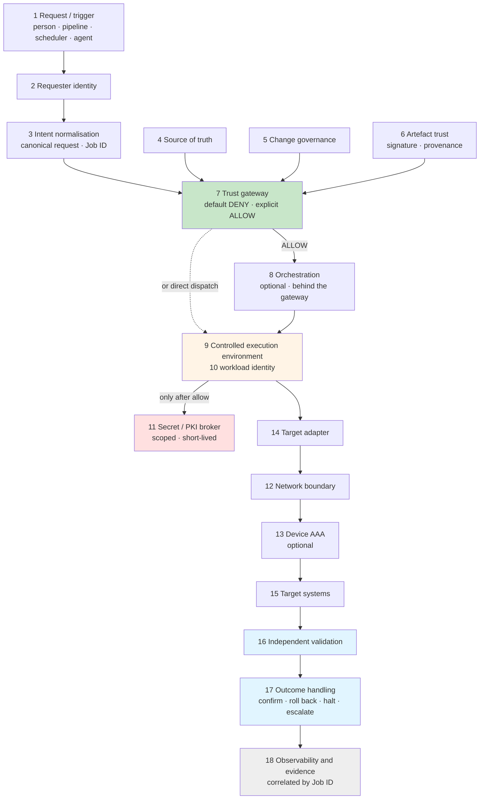
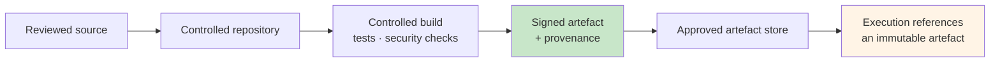
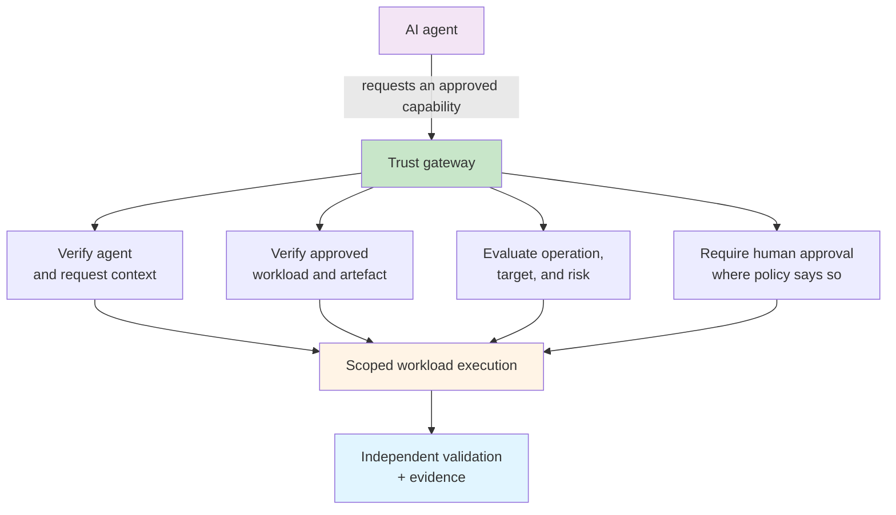

## The Full Reference Architecture

This is the strongest version of the model: the target state when every supporting system is available. That means enterprise identity, source control, build, signing, provenance, policy, secrets or privileged access management, isolated execution, a source of truth, validation, telemetry, and evidence.

Starting there is deliberate. Defining the destination first is what lets you make the reductions honestly. A team that starts from what it already has tends to draw an architecture around it, and then cannot tell which of its gaps are acceptable and which one is the next incident. The [adoption profiles](./adoption-profiles.md) are those reductions, made on purpose.

!!! tip "Responsibilities, not products"
    As with the [Governed Automation Reference Architecture](../../standards/reference-architecture.md), every module below is named for what it must establish. A policy engine, a vault, a pipeline, or a runner you already own may fill several of them. A module nobody owns is the finding. The [worked example](./worked-example-azure-cisco.md) shows one complete mapping onto real products.

---

## Modular by Design

!!! quote "The design principle"
    **The security properties are mandatory. The products implementing them are replaceable.**

The architecture is eighteen modules joined by contracts. Each module consumes and produces something defined — a canonical request, a decision, a scoped credential, a validation result, an evidence event — rather than depending on the product next to it. That is what lets a module be swapped or removed without breaking the workflow. Replace the product behind a module, and as long as the replacement honours the same contract, nothing on either side of it has to change.

There are three kinds of change, and each has a rule:

| Change | Allowed for | Rule |
|---|---|---|
| **Swap the product** | Every module | The replacement honours the same inputs, outputs, policy, and evidence contracts |
| **Omit when not triggered** | Conditional modules | Only while the condition that requires the module does not apply, and the reason is recorded |
| **Remove entirely** | Optional modules | The change in assurance or functionality is recorded, and anything the trust decision relied on is still established another way |

### Module classes

| Class | Meaning | Can it be removed? |
|---|---|---|
| **● Core** | A required capability. Its implementation is replaceable | No |
| **◆ Conditional** | Required when the execution scenario triggers it | Only when its condition does not apply |
| **○ Optional** | An additional integration, assurance, or operational capability | Yes, with the impact recorded |

A core module can be replaced but never removed. A deployment without a trust gateway, a network boundary, independent validation, or evidence is not a smaller version of this architecture. It is a different one.

!!! note "Conformance"
    A deployment conforms when every core module exists, every applicable conditional requirement is satisfied, every optional omission is explicit, and every replacement honours the same inputs, outputs, policy, and evidence contracts. It also keeps all [ten invariants](./index.md#ten-invariants) and the [controls that keep trust withdrawable](#10-keep-trust-withdrawable): removing a module never removes the property an invariant protects.

Leaving out an optional module is a recorded decision, not an oversight. Where a workload's [risk class](#risk-classes-and-what-the-gateway-demands) would call for the module, its absence is an [exception](../../production-grade-network-automation-principles/exception-and-waiver-process.md), with an owner and an expiry.

### Four planes

The modules fall into four planes, each answering one question.

| Plane | Question | Modules |
|---|---|---|
| **Control** | Should this happen? | Request, requester identity, intent, source of truth, change governance, artefact trust, and the trust gateway's decision |
| **Execution** | How can it happen safely? | Orchestration, the execution environment, workload identity, secrets, the network boundary, device authorisation, and target adapters |
| **Validation** | Did reality become the approved intent? | Independent observation, comparison with intent, and outcome handling |
| **Observability and evidence** | Can we prove what happened? | Job-ID correlation across application events, decisions, AAA accounting, device logs, platform logs, and validation results |

The fourth plane spans the other three. Evidence is not a step at the end; every module contributes to it.

### The module catalogue

Each module sits under one of the [nine sentences](./index.md#the-model-in-nine-sentences). Workload identity serves two of them: it is an input to the decision, and it is how the workload later proves itself to the secrets broker.

| # | Module | Class | Plane | Sentence | Must establish |
|---|---|---|---|---|---|
| 1 | **Request / Trigger** | ● Core | Control | 1 | A controlled entry point. Every route converges on one execution contract |
| 2 | **Caller / Requester Identity** | ◆ Conditional | Control | 1 | Who or what originated the request. The mechanism is conditional; attribution is not |
| 3 | **Intent Normalisation** | ● Core | Control | 4 | One canonical request schema, a classified operation, and the Job ID |
| 4 | **Source of Truth** | ○ Optional | Control | 5 | Authoritative facts about targets. If absent, those facts are still established another way |
| 5 | **Change Governance / Approval** | ◆ Conditional | Control | 4 | Change record, approval, risk, and window, when policy requires them |
| 6 | **Artefact Trust** | ● Core | Control | 2, 3 | Exactly what will run, and that it is an approved release |
| 7 | **Trust Gateway / Policy Decision** | ● Core | Control | 4 | Whether privilege may be exercised: allow, deny, or escalate, with reasons |
| 8 | **Orchestration** | ○ Optional | Execution | 7 | Workflow, dependencies, scheduling, and dispatch. Never the trust decision |
| 9 | **Controlled Execution Environment** | ● Core | Execution | 7 | An isolated, reproducible, least-privileged runtime |
| 10 | **Workload / Machine Identity** | ◆ Conditional | Execution | 1, 6 | An attributable runtime identity, distinct from the requester's |
| 11 | **Secret / PKI Broker** | ◆ Conditional | Execution | 6 | Credentials, certificates, or keys, released only after an allow |
| 12 | **Network Boundary** | ● Core | Execution | 5 | Reachability restricted to the approved targets and supporting services |
| 13 | **Device AAA / Authorisation** | ○ Optional | Execution | 5 | A target-side check on who may run what, with accounting |
| 14 | **Target Adapter** | ● Core | Execution | 7 | Approved, platform-neutral intent translated into the target's protocol or API |
| 15 | **Target System** | ● Core | Execution | 7 | The managed system itself, and the controls it contributes |
| 16 | **Independent Validation** | ● Core | Validation | 8 | Observed state compared with approved intent, independently of the executor |
| 17 | **Outcome / Failure Handling** | ● Core | Validation | 8 | An explicit terminal state, and the operation's declared rollback, halt, or escalation |
| 18 | **Observability & Evidence** | ● Core | Observability and evidence | 9 | A correlated record of the whole transaction, reconstructable by Job ID |

Eleven core, four conditional, three optional. In the target state on this page all eighteen are present, including the optional ones. The [adoption profiles](./adoption-profiles.md) are where you decide which conditional and optional modules each workload needs, and how strongly each module is enforced.

---

## The Target State



Evidence is drawn once, at the end, for readability. In practice every module above writes to it, tagged with the same Job ID.

Look at where the secrets broker sits: below the trust gateway. In most estates it is effectively at the top, because the credential exists before anyone has asked for anything.

Two structural rules fall out of the diagram:

- **There is one way in.** If a caller can reach the same credential or the same target by another route — a second trigger, an orchestrator's own interface, a direct login — the gateway is advisory. Bypass paths are found and closed, not documented.
- **The decision is not made by the thing being decided about.** The workload supplies evidence. It never evaluates it.

### The publication path

Runtime verification is only as meaningful as the evidence it verifies. The gateway can check a signature and a provenance record at execution time, but only if something trustworthy produced them earlier. This is the inside of module 6.



[SLSA](https://slsa.dev/provenance/) defines provenance as verifiable information about where, when, and how an artefact was produced. Its [verification guidance](https://slsa.dev/spec/v1.2/verifying-artifacts) checks that information against trusted builder identities and expected build parameters, rather than accepting the presence of metadata as proof. That distinction matters here. A provenance record nobody verifies is decoration.

---

## Module by Module

The eighteen modules, grouped under the [nine sentences](./index.md#the-model-in-nine-sentences) from the overview, plus a tenth group of cross-cutting controls for keeping trust withdrawable once it has been given. Where a module carries several requirements, each gets its own row.

### 1. Prove who is asking

| Module | Why it exists | Target state |
|---|---|---|
| **1. Request / Trigger** ● — the controlled entry point | Every separate route into execution is a separate boundary to secure. A portal, an API, a scheduler, and an agent with their own paths to the runner are four gateways, not one | One controlled entry contract that every route — ITSM, API, webhook, scheduler, Git event, agent — converges on. The Job ID is issued at acceptance and carried downstream |
| **2. Requester identity** ◆ — who or what started the run | Without it, an approved workload becomes a generic privileged back door. The same artefact can be acceptable when one principal invokes it and unacceptable when another does | Strong authentication, a non-repudiable request identifier, role and entitlement context, and approval context where it applies. The mechanism is conditional — a person signs in, a scheduler presents a trusted event identity — but attribution is never optional |
| **10. Workload identity** ◆ — the automation's own identity, distinct from the requester's | Authenticating the requester does not identify the code exercising privilege. Separating the two lets policy say *Alice may request the audit workload, and the audit workload may only read* | A stable workload identifier; in mature implementations, a short-lived cryptographic identity. [SPIFFE](https://spiffe.io/docs/latest/spiffe-about/overview/) is one standard built for exactly this. Conditional on the runtime and the resources it reaches: where no dedicated mechanism applies, the workload is still identified by its verified manifest and digest, never by its path or host |

Two identities, not one. The Governed Automation Reference Architecture already insists that [users and workloads authenticate separately](../../standards/reference-architecture.md#identity-and-data-flow), and this is why. A shared service account collapses both into a single principal, and policy can no longer tell who asked from what ran.

### 2. Prove what will run

| Module | Why it exists | Target state |
|---|---|---|
| **6. Artefact Trust** ● — artefact identity: exactly which executable content is proposed, as an immutable version | Names and paths are mutable labels. Policy has to reason about something that cannot change underneath it | Manifest metadata plus a cryptographic digest; in mature designs, the digest is bound to signed provenance and a release identity |
| **6. Artefact Trust** — artefact signing: that an authorised publisher or release process produced it | A digest detects change against an expected value. It does not, by itself, say who approved or produced the artefact | A trusted signing identity, a protected signing mechanism, rotation and revocation, and verification at the execution boundary, not only at publication |

This is the [remediation pack](../../production-grade-network-automation-principles/remediation-packs.md#immutability-and-the-checksum) argument applied to code rather than to a change. A checksum over a pack proves the change is the one that was approved. A digest and a signature over the workload prove the code applying it is the one that was reviewed. Most estates have neither, and the ones that have the first rarely have the second.

Source control alone is not this module. Build, test, promotion, and integrity evidence all belong to it.

### 3. Establish where it came from

| Module | Why it exists | Target state |
|---|---|---|
| **6. Artefact Trust** — build provenance: where the artefact came from and how it was produced | A valid signature is stronger when you can also verify the source, builder, and build parameters behind it | Signed provenance and an enforced verifier, checked against trusted builder identities and expected build inputs |
| **6. Artefact Trust** — dependency evidence: what the workload inherits | Approved first-party code still inherits the risk of everything it imports. Artefact trust cannot be a hash of the top-level script alone | Locked dependencies, vulnerability and policy checks, an SBOM or equivalent dependency evidence, and controlled package sources |

In most network automation the top-level script is a few hundred lines and the dependency tree is tens of thousands. Signing the script and ignoring the tree verifies the part least likely to be the problem. The [Python Engineering Standard](../../standards/python-engineering-standard.md) sets the dependency bar this module verifies.

### 4. Decide what it may do

| Module | Why it exists | Target state |
|---|---|---|
| **3. Intent Normalisation** ● — every request converted into one canonical form | Policy can only reason about what it can parse. If each trigger's own format reaches the decision, every format is a separate parser to get right and a separate way to slip a request past it | One canonical execution-request schema and operation taxonomy. Fields are validated, the operation is classified, and malformed or unclassifiable requests are rejected before any decision. Downstream modules depend on this contract, never on the original trigger |
| **7. Trust Gateway** ● — enforcement: the point every privileged run must enter through | If a caller can bypass the runner and use the same credential, or reach the same target directly, the architecture is advisory rather than enforcing | A mandatory gateway that validates evidence, obtains a decision, provisions execution, and refuses bypass paths. An orchestrator, if present, sits behind it |
| **7. Trust Gateway** — policy decision: whether this subject, workload, operation, target, and context are authorised now | Identity answers *who* and *what*. Policy answers *may this happen now?* Keeping policy outside the workload lets authorisation change without changing the code | Default deny, explicit and versioned policy, a machine-readable allow, deny, or escalate result with reason codes for every decision, and protected decision evidence |
| **7. Trust Gateway** — policy context: the facts the decision is made from | A policy engine cannot make a good decision from untrusted or stale inputs | Authoritative identity and source-of-truth data, integrity-protected context, freshness limits, and fail-closed handling when a mandatory signal is missing |
| **5. Change Governance / Approval** ◆ — an independent human decision where risk warrants it | Zero-touch is not always the right outcome. Destructive, exceptional, or broad changes justify separation of duties and explicit review | The [risk class](#risk-classes-and-what-the-gateway-demands) decides when approval is mandatory, and from R3 upward it always is. The approval is bound to the artefact, operation, scope, and window, never a reusable blanket permission. Conditional on policy: a read-only or low-risk operation may legitimately need none |

This is where *identity is not capability* is enforced. A request names the capability it wants, and policy grants or refuses that capability specifically. A verified compliance workload asking to reload a device is not a trusted workload doing something slightly unusual. It is a known workload making an unauthorised request, and the gateway has to be able to tell the difference.

The gateway can be one service, or an enforcement point in front of a separate decision engine. Either way it is one module with one contract, which is what lets the decision engine be swapped without anything upstream or downstream noticing.

### 5. Constrain where it may do it

| Module | Why it exists | Target state |
|---|---|---|
| **4. Source of Truth** ○ — what a target is, who owns it, and which scope it belongs to | Text supplied by the caller must not be able to redefine what a target is, or whether it is in scope | Validated inventory with [trust boundaries](../../production-grade-network-automation-principles/trust-boundaries-around-your-source-of-truth.md), ownership, and environment classification. Optional as a separate system, but not as a set of facts: without one, what a target is and whether it is in scope still come from a protected source, such as a reviewed allow-list |
| **12. Network Boundary** ● — what the workload can physically reach | Application policy is stronger when reachability reinforces it. Automation should not receive arbitrary reachability because it is trusted software, and a policy bug should not mean unrestricted reach | Default-deny segmentation and explicit egress for each execution environment, management-plane restrictions on the targets, and private access to supporting services |
| **13. Device AAA / Authorisation** ○ — a target-side check that does not depend on the automation stack | If everything upstream is wrong, the device should still refuse commands the workload's role was never given, and record the ones it ran | Per-role or per-capability device identities, command authorisation, and accounting held off the device. Without an AAA platform, local device RBAC is a lower-assurance compensating control, and the absence is recorded as an assurance reduction. The platform can be removed; target-side least privilege cannot |

Scope is constrained twice. Logically, targets are resolved through an authoritative source before policy evaluates them: a policy that evaluates the target name a caller typed has approved a string, and whatever the runner later resolves that string to was never decided on. Physically, the workload can reach only what it was approved to touch, so a mistake in policy does not become access to the whole estate.

This sentence and the one before it are separate questions, not separate moments. In the [execution lifecycle](#the-execution-lifecycle), targets are resolved at stage 5 and evaluated together with everything else at stage 6.

### 6. Grant only the authority required

| Module | Why it exists | Target state |
|---|---|---|
| **11. Secret / PKI Broker** ◆ — just-in-time, scoped privilege: authority created only after an allow, bounded in scope and lifetime | Standing credentials make the runner and the workload worth compromising. Delayed, time-bounded authority shrinks both the opportunity and the blast radius | Short-lived tokens or certificates, or brokered secrets, with narrow permissions, target restrictions, and automatic expiry or revocation where the platform supports it. The workload proves itself to the broker with its own identity (module 10) |
| **11. Secret / PKI Broker** — secrets handling: credential material kept out of source, logs, and persistent workload state | Trusting the artefact does not make leaking a secret acceptable. An exposed secret lets someone skip every future policy decision | An external secrets or PAM platform, retrieval only after allow, in-memory or platform-native delivery, redaction, and rotation. Conditional: a genuinely secretless, federated path does not add a vault retrieval to satisfy the diagram |

Note the dependency on groups 4 and 5. Retrieving secrets at runtime, the [runtime retrieval pattern](../../production-grade-network-automation-principles/secrets-and-credentials-in-enterprise-automation.md#runtime-retrieval-pattern), is necessary but not sufficient. What this architecture adds is *when*: the secret cannot be retrieved until the gateway has said yes, and [dynamic secrets](../../tutorials/expert/secure-credential-vaulting.md#dynamic-secrets-just-in-time-access) are one way to make sure it expires shortly afterwards.

### 7. Execute within defined boundaries

| Module | Why it exists | Target state |
|---|---|---|
| **8. Orchestration** ○ — workflow, dependencies, scheduling, and dispatch | Real changes have dependencies, schedules, and multi-step workflows, and an orchestrator coordinates them well. It is also a powerful system that can start jobs, which makes it a candidate second way in | If present, it sits behind the gateway and accepts work only from it. Its own interface, credentials, and schedules cannot start privileged execution, and the trust decision stays with the gateway. If absent, the gateway dispatches directly |
| **9. Controlled Execution Environment** ● — a clean, constrained environment for each run | A long-lived runner accumulates state, credentials, tools, and eventually compromise. Isolation stops one run or workload interfering with another | An ephemeral, reproducible VM, container, or sandbox from a hardened base image, with a restricted filesystem, controlled egress, least privilege, clean teardown, and runner attestation where available |
| **Pre-flight validation** — a requirement on modules 9 and 14 | An authorised change can still be unsafe when the target is unhealthy, unexpected, unreachable, or already changed | Identity, reachability, platform and version, state and capacity, window, and drift checks — see [Pre-Flight Checks](../../production-grade-network-automation-principles/pre-flight-checks-failing-fast-before-making-changes.md) |
| **Execution safeguards** — a requirement on modules 8, 9, and 14 | Approved automation still contains defects, and still meets production state nobody predicted | Canaries and batches, concurrency limits, [circuit breakers](../../tutorials/expert/circuit-breakers-backpressure-network-automation.md), timeouts, idempotency, dry-run where supported, stop conditions, and a rollback strategy chosen before the run |
| **14. Target Adapter** ● — approved intent translated into the target's protocol or API | If policy reasons in device command text, it cannot be platform-neutral, and a named operation quietly becomes free-form commands. A stable adapter contract keeps transport and vendor detail out of the policy layer | A defined interface per operation, with pluggable adapters for the CLI, NETCONF, RESTCONF, controllers, and other APIs. Adapters accept only named operations from approved intent, and model-driven access is governed as strictly as the CLI |
| **15. Target System** ● — the managed system itself | The target is part of the boundary, not outside it. Its own controls — confirmed commits, management-plane restrictions, local accounting — still work when everything upstream has failed | Open-ended target types: switches, routers, controllers, DDI, firewalls, cloud and other managed APIs. Each platform's controls are known, enabled, and tested at the software release you run |

This is the group where security and operational safety stop being separate subjects. A circuit breaker is an operational control, and it is also what stops a defective or compromised workload from reaching its fiftieth device. The [production-grade principles](../../production-grade-network-automation-principles/index.md) cover each of these in depth. The architecture's contribution is to make them conditions of execution rather than good habits.

### 8. Validate the resulting state independently

| Module | Why it exists | Target state |
|---|---|---|
| **16. Independent Validation** ● — the resulting state, evaluated separately from the code that produced it | An exit code of zero does not prove the infrastructure is correct. Asking the actor that made a change to grade its own work is not validation | Structured state collection and expected-versus-observed assertions (pyATS and Genie, or equivalent, in network environments), health checks, and a result of PASS, FAIL, DRIFT, or UNKNOWN — or PARTIAL, where some targets passed and others did not. UNKNOWN never counts as PASS. Validation uses lower privilege than the change path, ideally read-only |
| **17. Outcome / Failure Handling** ● — results turned into an explicit terminal state | A failed validation that only becomes a log line has changed nothing. A rollback decided in the moment, under pressure, is a rollback improvised | Every run ends in an explicit, machine-readable terminal state. Each operation declares in advance whether rollback is safe for it, because automatic rollback is not universal; where it is not, the run halts and escalates. Change and incident records are updated with the outcome |

Independence is the part that is easy to drop. A deployment script that runs its own checks at the end is better than one that runs none, but it shares every assumption, every parser, and every bug with the code it is checking. The capstone pipeline keeps the two apart for exactly this reason. [Proving the Change with PyATS](../../tutorials/capstone/06-proving-the-change-with-pyats.md) is built around a deploy that succeeded and an uplink that is down.

Outcome handling is where the invariant *failures are explicit* is enforced. A run that ends in an unrecorded state has failed silently, whatever its exit code says.

### 9. Prove what happened

| Module | Why it exists | Target state |
|---|---|---|
| **18. Observability & Evidence** ● — the evidence and audit record: the complete decision and execution story | Incident response, governance, and learning all depend on knowing what was requested, allowed, executed, and observed | One record per run, correlated by its Job ID, covering every field in [the evidence record](#the-evidence-record) below. Searching for the Job ID reconstructs the transaction |
| **18. Observability & Evidence** — tamper-resistant central evidence: important records held outside the workload's control | A compromised workload must not be able to erase the authoritative account of its own execution | A central evidence service with restricted write semantics, integrity and retention controls, synchronised time, and correlation IDs |
| **18. Observability & Evidence** — telemetry, detection, and response: security and operational behaviour observed and acted on | Execution trust is not a one-time guarantee. Conditions change during and after the run | SIEM and monitoring integration, alerts on policy denials, unusual target or scope detection, runner health, credential anomalies, and a response process |

Alert on denials. A gateway that refuses quietly is half a control: the refusal protected this run, but the attempt is information, and a pattern of attempts is an investigation. [Tool Contracts and Failure Modes](../../governed-ai-network-operations/tool-contracts-and-failure-modes.md) makes the same argument for agents.

### 10. Keep trust withdrawable

These are not modules in the catalogue, because each acts across all of them. They are required in every conformant deployment, whatever has been swapped or removed.

| Control | Why it exists | Target state |
|---|---|---|
| **Revocation and emergency stop** — trust, privilege, workload versions, and grants withdrawn quickly | A system that can grant authority but cannot rapidly revoke it is incomplete on the day a compromise or a defect is found | Disable a publisher or workload identity, revoke credentials and certificates, quarantine artefacts, block policy grants, and stop new executions at the gateway |
| **Break-glass path** — a controlled emergency route that does not quietly become the normal one | Pure fail-closed designs can collide with genuine emergency recovery. An explicit path is better than the unmanaged bypass people will otherwise build | A separate protected identity, a stated reason, narrow scope, strong logging, mandatory review, and post-event reconciliation |
| **Governance and lifecycle** — automation treated as a maintained privileged service, not a one-off script | Trust decays when ownership, dependencies, policy, and operational knowledge stop being maintained | Named owners, risk classification, recertification, vulnerability response, tests, runbooks, deprecation, and retirement, as the [Automation Service Lifecycle](../../production-grade-network-automation-principles/automation-service-lifecycle.md) describes |

Break-glass is the control most likely to be skipped and the one most likely to be needed. If you do not design it, it still exists: as a shared admin password in a spreadsheet, discovered during the review after the outage.

It is also not an [exception](../../production-grade-network-automation-principles/exception-and-waiver-process.md). An exception is a planned, time-bound deviation from a control. Break-glass is an unplanned emergency route through one. They need different approvals and leave different evidence.

---

## The Policy Decision

The decision is an evaluation of evidence, context, and requested capability, not a single trusted-or-untrusted flag.

```text
decision = f(
    job_id,
    requester_identity,
    workload_identity,
    artifact_digest,
    publisher_and_provenance,
    operation,                 # from the canonical request
    requested_capability,
    target_identity_and_classification,
    environment,
    change_and_approval_context,
    current_risk_and_posture,
    policy_version,
)

if mandatory evidence is missing or policy is not satisfied:
    DENY with reason codes
elif policy requires a human decision that has not been given:
    ESCALATE to change governance
else:
    ALLOW with constrained capability, scope, and lifetime,
          bound to this job_id and expiring
```

`ALLOW` is never unqualified. An allow carries its constraints with it — which capability, against which targets, for how long — and the secrets broker issues exactly that and no more. It is also bound to one request: a decision cannot be replayed for a different Job ID, and it expires if it is not used.

`ESCALATE` is not a soft deny. It routes the request to the approval path, and the request comes back to the gateway as a fresh evaluation once a human has decided. An escalation nobody answers expires as a deny.

The architecture does not prescribe a policy engine. A dedicated decision service, an existing platform's authorisation controls, or a version-controlled policy file evaluated by a trusted runner can each fill the role. What it requires is that the decision is:

- **external** to the workload it governs
- **reproducible** enough to explain afterwards: the same inputs and the same policy version give the same answer
- **enforceable** at the execution boundary, not merely recorded there
- **explained**, with reason codes a machine and an auditor can both read

`policy_version` is an input for the second reason. An auditor asking why a run was allowed in March needs the policy as it stood in March.

---

## The Execution Lifecycle

Fifteen stages. The workload holds privilege only between stages 7 and 13.

| Stage | What happens |
|---|---|
| **1. Request** | A human, CI workflow, scheduler, or governed agent submits a request referencing an immutable workload release and an intended target scope. It is normalised into the canonical schema, and the Job ID is issued |
| **2. Authenticate the requester** | The gateway establishes the initiating identity and its authorisation and approval context |
| **3. Resolve the workload** | The gateway obtains the approved workload manifest, version, and immutable artefact identity |
| **4. Verify the supply chain** | Signature, digest, provenance, and any required dependency evidence are verified, as policy requires |
| **5. Resolve targets** | Requested targets are mapped through the source of truth and classified by environment and risk |
| **6. Evaluate policy** | Requester, workload, operation, targets, context, and approvals are evaluated. Missing mandatory evidence means deny. An escalation returns here once a human has decided |
| **7. Acquire privilege** | Only after an allow: narrowly scoped, preferably short-lived authority is issued or brokered |
| **8. Prepare the runner** | A constrained environment is created or selected, directly or through the orchestrator, with only the network and system access it needs |
| **9. Pre-flight** | Target identity, state, and operational prerequisites are confirmed |
| **10. Execute safely** | The operation runs through the target adapter, with batching, timeouts, circuit breakers, and stop and rollback criteria matched to its risk. Device AAA authorises each command where it is present |
| **11. Validate independently** | A separate validation path gathers state and returns PASS, FAIL, DRIFT, UNKNOWN, or PARTIAL |
| **12. Determine the outcome** | The result becomes an explicit terminal state. The operation's declared rollback, halt, or escalation is applied, and change records are updated |
| **13. Close authority** | Temporary authority expires or is revoked, and ephemeral execution state is destroyed |
| **14. Preserve evidence** | Decision, execution, validation, outcome, and exception evidence is committed centrally under the Job ID |
| **15. Observe and respond** | Telemetry is assessed for policy violations, failures, anomalies, and follow-up |

For a change, the [remediation pack](../../production-grade-network-automation-principles/remediation-packs.md) travels with the request at stage 1, and its [revalidation](../../production-grade-network-automation-principles/remediation-packs.md#revalidation-before-execution) happens at stage 9.

Map your current automation onto this table and the usual result is that stages 7, 10, and part of 14 exist, and everything else is implicit. That is not a failing grade. It is the starting position the [adoption profiles](./adoption-profiles.md) are written for.

---

## Risk Classes and What the Gateway Demands

The architecture uses the site's existing [automation risk classes](../../production-grade-network-automation-principles/enterprise-control-matrix.md#automation-risk-classification) unchanged. Every class goes through the gateway, including read-only work, because a read is still privileged access: `show running-config` is a read that can expose every credential on a device. What the class changes is how much the gateway demands before it says yes.

| Class | What the gateway demands |
|---|---|
| **R0 — Informational** | Workload integrity, requester identity, policy, and target scope all pass. Credentials are brokered after the allow decision, never held in advance |
| **R1 — Advisory** | As R0. The workload may propose, but its policy grant contains no write capability, so it cannot act on its own proposal |
| **R2 — Controlled execution** | R1, plus pre-flight checks and bounded concurrency and timeouts. The capability granted is a named operation, never free-form command text |
| **R3 — Change automation** | R2, plus an approval bound to the artefact, operation, scope, and window; staged rollout; independent post-change validation; and a rollback path chosen before the run |
| **R4 — High-impact or autonomous** | R3, plus formal risk acceptance, a documented and tested emergency stop, deliberately narrowed scope, and enhanced monitoring — and, from this architecture, separation of duties between requester and approver, very short-lived capability-specific authority, and canary execution with automated stop conditions |

R3 covers a wide range of change, and the form of approval should scale within it:

- **Small, deterministic, reversible change** — a port description, an access VLAN on one port. Approval can be granted once, as a standard change bound to a specific artefact version and a bounded scope, with an expiry. Every run still passes pre-flight and post-change validation.
- **Broad or material change** — many devices, or one important one. A per-execution approval, staged rollout, and an explicit rollback path.
- **Upgrades, reloads, and changes to security controls** — an approver independent of the requester, binding to a change window, canary stages, and just-in-time privilege. Where scale makes this R4, classify it as R4.

In every case the approval is a record with a named approver and an expiry, as [NP-CHG-03](../../standards/control-catalogue.md#np-chg-change-control) requires. A standard change is an approval given in advance, not an approval skipped.

**Break-glass is not a class.** Emergency, destructive, or unusually sensitive authority outside these paths goes through the break-glass route described in [group 10](#10-keep-trust-withdrawable), and every use of it is reviewed afterwards.

---

## The Evidence Record

A run should be reconstructable as a chain of decisions and outcomes. Without recording any secret, capture:

- a unique Job ID, issued at acceptance and used as the correlation ID everywhere
- requester identity, with its authentication and approval context
- workload identity, version, digest, and the result of publisher and provenance verification
- policy version, decision, reason codes, and the context it evaluated
- the capability requested and the capability authorised, recorded separately
- resolved target identities with their environment and risk classification
- a reference to the privilege issued — an issuance identifier, never the secret itself
- runner identity and posture, where available
- the pre-flight result
- execution stages and their bounded results
- the independent validation result
- the terminal outcome, and any revocation, rollback, escalation, or exception events
- start and end timestamps

This extends the [per-run evidence model](../../production-grade-network-automation-principles/building-audit-ready-automation.md#evidence-model-per-run) in Building Audit-Ready Automation with the trust decision itself. That page records what the run did. This adds why it was allowed to.

### The Job ID and evidence contract

Every accepted request receives a globally unique Job ID. Wherever integration permits, it travels with the policy decision, orchestration, application events, target-side markers, validation records, and the final outcome. Searching the central evidence platform for one Job ID should reconstruct the transaction.

The field names below are the minimum contract. Keeping them stable is what lets the evidence backend be swapped: a new platform has to accept the same events, not a new schema.

| Field | Meaning |
|---|---|
| `job_id` | Global correlation identifier, issued at acceptance |
| `change_id` | Change or ITSM reference, where one applies |
| `requester` | The attributed caller |
| `approved_by` | The approver, where one applies |
| `application` | The automation component emitting the event |
| `workload_identity` | The runtime principal, where one applies |
| `execution_identity` | The identity used on the target |
| `target` | The managed device or system |
| `operation` | The canonical operation |
| `capability_requested` / `capability_authorised` | Recorded separately, so the gap between them is visible |
| `artifact_version` / `artifact_digest` | The trusted code identity |
| `policy_version` / `decision` / `reason_codes` | The trust decision and its context |
| `privilege_reference` | An issuance identifier for the authority granted — never the secret |
| `source` | Where execution ran: the runner or trusted zone |
| `preflight_result` | Pass, fail, or the targets excluded |
| `validation_result` | PASS, FAIL, DRIFT, UNKNOWN, or PARTIAL |
| `result` | The final job state |
| `timestamp` | Event time, from synchronised clocks |

Where a platform supports it, a target-side marker carrying the Job ID — in the device's own log or configuration archive — lets device-side records join the same thread. The mechanism differs by platform and software release, so verify it on each one before relying on it.

!!! warning "Evidence safety"
    Record credential references, authorisation decisions, and retrieval outcomes. Never record passwords, secret values, private keys, session cookies, or access and refresh tokens.

---

## AI-Triggered Automation

The model matters most when an AI system can request operational actions. The agent becomes **another requester, not a privileged exception**.



The agent never receives a generic execution capability that sidesteps the gateway. That case is argued in full in [Why Your Agent Must Not Have an execute_command Tool](../../governed-ai-network-operations/why-your-agent-must-not-have-execute-command.md). Its requests enter through the same request contract as everyone else's (module 1) and are normalised the same way (module 3), so an agent cannot invent an operation the taxonomy does not contain.

What Trusted Automation Execution adds is that the governed tools an agent calls are themselves workloads. Each call is identified, verified, checked against policy, and given scoped authority, exactly as it would be for an engineer or a pipeline. Both the agent's [AI risk class](../../governed-ai-network-operations/ai-risk-classification.md) and the workflow's R class apply.

---

## Mapping to the Control Catalogue

Most of this architecture is already required, piece by piece, by the [Automation Control Catalogue](../../standards/control-catalogue.md). What it adds is the ordering — evidence before privilege — and a handful of requirements the catalogue does not yet state.

| Group (modules) | Catalogue controls it satisfies | Where this architecture goes further |
|---|---|---|
| **1. Who is asking** (1, 2, 10) | NP-TOOL-04, NP-EVD-01 | One entry contract for every route, and a workload identity distinct from the requester's, used as a policy input |
| **2. What will run** (6) | NP-PLAT-02, NP-PLAT-05, NP-CHG-02 | Digest and signature verified at the execution boundary on every run, not only at build or promotion |
| **3. Where it came from** (6) | NP-PLAT-02, NP-PLAT-04, NP-PLAT-06 | Provenance *verified* against the expected builder and inputs, not merely recorded |
| **4. What it may do** (3, 5, 7) | NP-CORE-03, NP-CORE-04, NP-CORE-08, NP-CHG-03, NP-TOOL-04, NP-AI-01, NP-AI-05 | One mandatory enforcement point for every requester — human, pipeline, or agent — deciding on a canonical request, with bypass paths closed |
| **5. Where it may do it** (4, 12, 13) | NP-CORE-01, NP-CORE-06, NP-TOOL-04, NP-PLAT-01 | Network and target-side enforcement that holds even when policy is wrong |
| **6. Only the authority required** (11) | NP-PLAT-01, NP-PLAT-03 | Credentials unavailable until after an allow decision, and expiring with the run |
| **7. Within defined boundaries** (8, 9, 14, 15) | NP-CORE-02, NP-CORE-05, NP-CORE-06, NP-CORE-07, NP-CORE-08, NP-CHG-04, NP-CHG-06 | Ephemeral runners with clean teardown, so no run inherits another's state or credentials, and no orchestrator acting as a second way in |
| **8. Validate independently** (16, 17) | NP-CHG-05 | Validation performed independently of the workload, with its own result, for read-only runs as well as changes, and an explicit terminal state for every run |
| **9. What happened** (18) | NP-EVD-01, NP-EVD-02, NP-EVD-04, NP-EVD-05, NP-TOOL-07 | The trust decision itself in the record, correlated by Job ID and held where the workload cannot alter it |
| **10. Withdrawable** | NP-GOV-01, NP-GOV-02, NP-GOV-04, NP-GOV-07, NP-TOOL-08 | Rapid revocation of a workload, publisher, or grant at the gateway, and a designed break-glass route |

The right-hand column is what an assessment against the catalogue alone would not catch.

---

## Open Design Decisions

Every implementation has to answer these. The architecture deliberately does not settle them, because the right answer depends on the platforms in front of you. The [worked example](./worked-example-azure-cisco.md) answers several for one stack, and any proof of concept should test its answers rather than assume them.

- The canonical execution-request schema, the operation taxonomy, and the Job ID format
- The trust gateway's policy inputs, decision format, reason codes, and decision expiry and replay protection
- How change-governance state reaches the gateway securely: fetched from its source or signed, never asserted by the caller
- How artefacts are promoted, and exactly which digest and signature mechanism the executor verifies
- How different execution environments — a container platform, an orchestrator's execution environment, a hardened host — satisfy the same runtime contract
- How workload identity and secret access are scoped per automation function
- The network flows each execution environment needs, and the default-deny policy around them
- Device AAA command sets per automation role, and whether source-address restrictions actually work for your AAA and device combination
- The adapter interface for direct device, controller, and DDI operations
- The validation strategy for each operation, including how UNKNOWN and PARTIAL results are handled
- The evidence event schema, its transport, buffering and retry behaviour, and retention
- The target-side Job ID marker for each supported platform and software release
- Failure simulations: a denied policy, a missing approval, a secrets platform failure, an AAA denial, an unreachable target, partial execution, a validation mismatch, and an observability outage

!!! note "Verify before prescribing"
    Product capabilities, platform versions, exact APIs and commands, AAA source-address conditions, and device-side logging mechanisms must be verified against the versions actually deployed before they become prescriptive configuration.

---

## Ten Things That Must Be True

The architecture is working when all of these hold.

1. An altered workload cannot exercise privileged authority.
2. An approved workload cannot exceed its declared and authorised capability.
3. An approved workload cannot silently expand to unauthorised targets.
4. A caller cannot bypass the enforcement path to obtain the same authority.
5. In the target state, privilege does not exist before the trust decision.
6. High-risk actions can require independent approval.
7. Operational success is determined by independent validation, not by process exit status.
8. Every privileged run can be correlated to its requester, workload, decision, scope, result, and evidence.
9. Trust can be revoked quickly — for a workload, a publisher, a policy grant, or a credential path.
10. The architecture can be implemented at lower maturity without redefining its trust principles.

The first nine double as acceptance tests for any implementation, at any profile, and with any combination of products behind the modules. The tenth is a test of the architecture itself, and the [adoption profiles](./adoption-profiles.md) are the evidence offered for it.

---

## Continue

- Previous: [Trusted Automation Execution](./index.md)
- Next: [Threat and Failure Model](./threat-and-failure-model.md)
- Related: [Governed Automation Reference Architecture](../../standards/reference-architecture.md) · [Remediation Packs](../../production-grade-network-automation-principles/remediation-packs.md)
