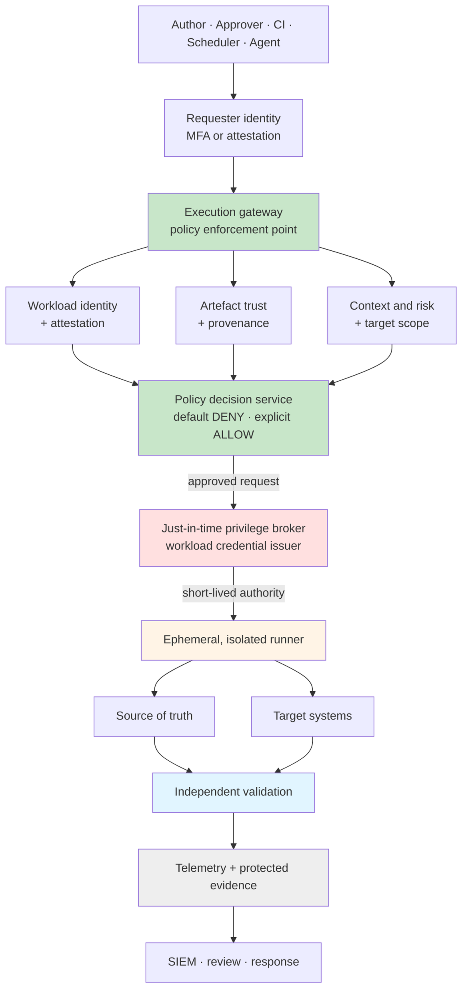
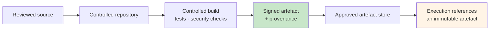
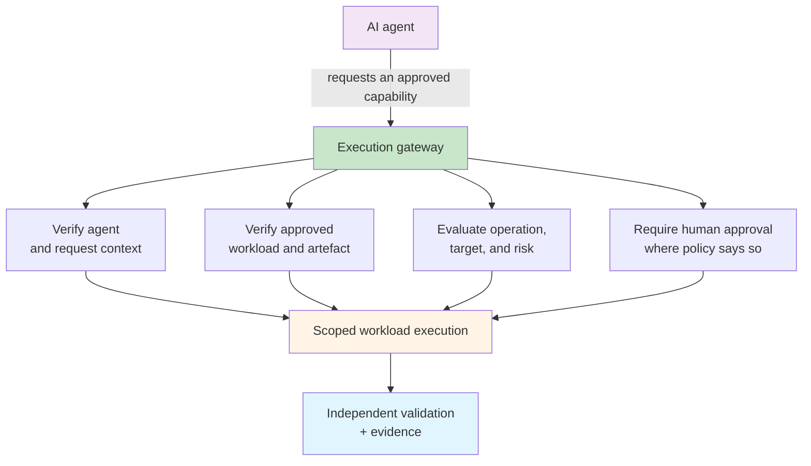

## The Full Reference Architecture

This is the strongest version of the model: the target state when every supporting system is available. That means enterprise identity, source control, build, signing, provenance, policy, secrets or privileged access management, isolated execution, a source of truth, validation, telemetry, and evidence.

Starting there is deliberate. Defining the destination first is what lets you make the reductions honestly. A team that starts from what it already has tends to draw an architecture around it, and then cannot tell which of its gaps are acceptable and which one is the next incident. The [adoption profiles](./adoption-profiles.md) are those reductions, made on purpose.

!!! tip "Responsibilities, not products"
    As with the [Governed Automation Reference Architecture](../../standards/reference-architecture.md), every component below is named for what it must establish. A policy engine, a vault, a pipeline, or a runner you already own may fill several of them. A component nobody owns is the finding. The [worked example](./worked-example-azure-cisco.md) shows one complete mapping onto real products.

---

## The Target State



Look at where the privilege broker sits: below the policy decision. In most estates it is effectively at the top, because the credential exists before anyone has asked for anything.

Two structural rules fall out of the diagram:

- **There is one way in.** If a caller can reach the same credential or the same target by another route, the gateway is advisory. Bypass paths are found and closed, not documented.
- **The decision is not made by the thing being decided about.** The workload supplies evidence. It never evaluates it.

### The publication path

Runtime verification is only as meaningful as the evidence it verifies. The gateway can check a signature and a provenance record at execution time, but only if something trustworthy produced them earlier.



[SLSA](https://slsa.dev/provenance/) defines provenance as verifiable information about where, when, and how an artefact was produced. Its [verification guidance](https://slsa.dev/spec/v1.2/verifying-artifacts) checks that information against trusted builder identities and expected build parameters, rather than accepting the presence of metadata as proof. That distinction matters here. A provenance record nobody verifies is decoration.

---

## Component by Component

Twenty-four components, grouped under the [nine sentences](./index.md#the-model-in-nine-sentences) from the overview, plus a tenth group for keeping trust withdrawable once it has been given.

### 1. Prove who is asking

| Component | Why it exists | Target state |
|---|---|---|
| **Requester identity** — who or what started the run | Without it, an approved workload becomes a generic privileged back door. The same artefact can be acceptable when one principal invokes it and unacceptable when another does | Strong authentication, a non-repudiable request identifier, role and entitlement context, and approval context where it applies |
| **Workload identity** — the automation's own identity, distinct from the requester's | Authenticating the requester does not identify the code exercising privilege. Separating the two lets policy say *Alice may request the audit workload, and the audit workload may only read* | A stable workload identifier; in mature implementations, a short-lived cryptographic identity. [SPIFFE](https://spiffe.io/docs/latest/spiffe-about/overview/) is one standard built for exactly this |

Two identities, not one. The Governed Automation Reference Architecture already insists that [users and workloads authenticate separately](../../standards/reference-architecture.md#identity-and-data-flow), and this is why. A shared service account collapses both into a single principal, and policy can no longer tell who asked from what ran.

### 2. Prove what will run

| Component | Why it exists | Target state |
|---|---|---|
| **Artefact identity** — exactly which executable content is proposed, as an immutable version | Names and paths are mutable labels. Policy has to reason about something that cannot change underneath it | Manifest metadata plus a cryptographic digest; in mature designs, the digest is bound to signed provenance and a release identity |
| **Artefact signing** — that an authorised publisher or release process produced it | A digest detects change against an expected value. It does not, by itself, say who approved or produced the artefact | A trusted signing identity, a protected signing mechanism, rotation and revocation, and verification at the execution boundary, not only at publication |

This is the [remediation pack](../../production-grade-network-automation-principles/remediation-packs.md#immutability-and-the-checksum) argument applied to code rather than to a change. A checksum over a pack proves the change is the one that was approved. A digest and a signature over the workload prove the code applying it is the one that was reviewed. Most estates have neither, and the ones that have the first rarely have the second.

### 3. Establish where it came from

| Component | Why it exists | Target state |
|---|---|---|
| **Build provenance** — where the artefact came from and how it was produced | A valid signature is stronger when you can also verify the source, builder, and build parameters behind it | Signed provenance and an enforced verifier, checked against trusted builder identities and expected build inputs |
| **Dependency evidence** — what the workload inherits | Approved first-party code still inherits the risk of everything it imports. Artefact trust cannot be a hash of the top-level script alone | Locked dependencies, vulnerability and policy checks, an SBOM or equivalent dependency evidence, and controlled package sources |

In most network automation the top-level script is a few hundred lines and the dependency tree is tens of thousands. Signing the script and ignoring the tree verifies the part least likely to be the problem. The [Python Engineering Standard](../../standards/python-engineering-standard.md) sets the dependency bar this component verifies.

### 4. Decide what it may do

| Component | Why it exists | Target state |
|---|---|---|
| **Execution gateway** — the enforcement point every privileged run must enter through | If a caller can bypass the runner and use the same credential, or reach the same target directly, the architecture is advisory rather than enforcing | A mandatory gateway that validates evidence, obtains a decision, provisions execution, and refuses bypass paths |
| **Policy decision service** — whether this subject, workload, operation, target, and context are authorised now | Identity answers *who* and *what*. Policy answers *may this happen now?* Keeping policy outside the workload lets authorisation change without changing the code | Default deny, explicit and versioned policy, an explainable reason for every decision, and protected decision evidence where it matters |
| **Policy context** — the facts the decision is made from | A policy engine cannot make a good decision from untrusted or stale inputs | Authoritative identity and source-of-truth data, integrity-protected context, freshness limits, and fail-closed handling when a mandatory signal is missing |
| **Human approval** — an independent human decision where risk warrants it | Zero-touch is not always the right outcome. Destructive, exceptional, or broad changes justify separation of duties and explicit review | The [risk class](#risk-classes-and-what-the-gateway-demands) decides when approval is mandatory. The approval is bound to the artefact, operation, scope, and window, never a reusable blanket permission |

This is where *identity is not capability* is enforced. A request names the capability it wants, and policy grants or refuses that capability specifically. A verified compliance workload asking to reload a device is not a trusted workload doing something slightly unusual. It is a known workload making an unauthorised request, and the gateway has to be able to tell the difference.

### 5. Constrain where it may do it

| Component | Why it exists | Target state |
|---|---|---|
| **Authoritative source of truth** — what a target is, who owns it, and which scope it belongs to | Text supplied by the caller must not be able to redefine what a target is, or whether it is in scope | Validated inventory with [trust boundaries](../../production-grade-network-automation-principles/trust-boundaries-around-your-source-of-truth.md), ownership, and environment classification |
| **Network and target enforcement** — what the workload can physically reach, not only what policy says it may target | Application policy is stronger when network reachability and target-side authorisation reinforce it. A policy bug should not mean unrestricted reach | Segmentation, management-plane restrictions, explicit egress, and target-side RBAC or ACLs |

Scope is constrained twice. Logically, targets are resolved through an authoritative source before policy evaluates them: a policy that evaluates the target name a caller typed has approved a string, and whatever the runner later resolves that string to was never decided on. Physically, the workload can reach only what it was approved to touch, so a mistake in policy does not become access to the whole estate.

This sentence and the one before it are separate questions, not separate moments. In the [execution lifecycle](#the-execution-lifecycle), targets are resolved at stage 5 and evaluated together with everything else at stage 6.

### 6. Grant only the authority required

| Component | Why it exists | Target state |
|---|---|---|
| **Just-in-time, scoped privilege** — authority created only after an allow, bounded in scope and lifetime | Standing credentials make the runner and the workload worth compromising. Delayed, time-bounded authority shrinks both the opportunity and the blast radius | Short-lived tokens or certificates, or brokered secrets, with narrow permissions, target restrictions, and automatic expiry or revocation where the platform supports it |
| **Secrets handling** — credential material kept out of source, logs, and persistent workload state | Trusting the artefact does not make leaking a secret acceptable. An exposed secret lets someone skip every future policy decision | An external secrets or PAM platform, retrieval only after allow, in-memory or platform-native delivery, redaction, and rotation |

Note the dependency on groups 4 and 5. Retrieving secrets at runtime, the [runtime retrieval pattern](../../production-grade-network-automation-principles/secrets-and-credentials-in-enterprise-automation.md#runtime-retrieval-pattern), is necessary but not sufficient. What this architecture adds is *when*: the secret cannot be retrieved until the gateway has said yes, and [dynamic secrets](../../tutorials/expert/secure-credential-vaulting.md#dynamic-secrets-just-in-time-access) are one way to make sure it expires shortly afterwards.

### 7. Execute within defined boundaries

| Component | Why it exists | Target state |
|---|---|---|
| **Isolated, ephemeral runner** — a clean, constrained environment for each run | A long-lived runner accumulates state, credentials, tools, and eventually compromise. Isolation stops one run or workload interfering with another | An ephemeral VM, container, or sandbox from a hardened base image, with a restricted filesystem, controlled egress, clean teardown, and runner attestation where available |
| **Pre-flight validation** — prerequisites confirmed before any write begins | An authorised change can still be unsafe when the target is unhealthy, unexpected, unreachable, or already changed | Identity, reachability, platform and version, state and capacity, window, and drift checks — see [Pre-Flight Checks](../../production-grade-network-automation-principles/pre-flight-checks-failing-fast-before-making-changes.md) |
| **Execution safeguards** — blast radius bounded during the run | Approved automation still contains defects, and still meets production state nobody predicted | Canaries and batches, concurrency limits, [circuit breakers](../../tutorials/expert/circuit-breakers-backpressure-network-automation.md), timeouts, idempotency, dry-run where supported, stop conditions, and a chosen rollback strategy |

This is the group where security and operational safety stop being separate subjects. A circuit breaker is an operational control, and it is also what stops a defective or compromised workload from reaching its fiftieth device. The [production-grade principles](../../production-grade-network-automation-principles/index.md) cover each of these in depth. The architecture's contribution is to make them conditions of execution rather than good habits.

### 8. Validate the resulting state independently

| Component | Why it exists | Target state |
|---|---|---|
| **Independent post-execution validation** — the resulting state, evaluated separately from the code that produced it | An exit code of zero does not prove the infrastructure is correct. Asking the actor that made a change to grade its own work is not validation | Structured state collection, expected-versus-observed assertions (pyATS and Genie, or equivalent, in network environments), health checks, and clear pass or fail evidence |

Independence is the part that is easy to drop. A deployment script that runs its own checks at the end is better than one that runs none, but it shares every assumption, every parser, and every bug with the code it is checking. The capstone pipeline keeps the two apart for exactly this reason. [Proving the Change with PyATS](../../tutorials/capstone/06-proving-the-change-with-pyats.md) is built around a deploy that succeeded and an uplink that is down.

### 9. Prove what happened

| Component | Why it exists | Target state |
|---|---|---|
| **Evidence and audit record** — the complete decision and execution story | Incident response, governance, and learning all depend on knowing what was requested, allowed, executed, and observed | One correlated record covering every category in [the evidence record](#the-evidence-record) below |
| **Tamper-resistant central evidence** — important records held outside the workload's control | A compromised workload must not be able to erase the authoritative account of its own execution | A central evidence service with restricted write semantics, integrity and retention controls, synchronised time, and correlation IDs |
| **Telemetry, detection, and response** — security and operational behaviour observed and acted on | Execution trust is not a one-time guarantee. Conditions change during and after the run | SIEM and monitoring integration, alerts on policy denials, unusual target or scope detection, runner health, credential anomalies, and a response process |

Alert on denials. A gateway that refuses quietly is half a control: the refusal protected this run, but the attempt is information, and a pattern of attempts is an investigation. [Tool Contracts and Failure Modes](../../governed-ai-network-operations/tool-contracts-and-failure-modes.md) makes the same argument for agents.

### 10. Keep trust withdrawable

| Component | Why it exists | Target state |
|---|---|---|
| **Revocation and emergency stop** — trust, privilege, workload versions, and grants withdrawn quickly | A system that can grant authority but cannot rapidly revoke it is incomplete on the day a compromise or a defect is found | Disable a publisher or workload identity, revoke credentials and certificates, quarantine artefacts, block policy grants, and stop new executions at the gateway |
| **Break-glass path** — a controlled emergency route that does not quietly become the normal one | Pure fail-closed designs can collide with genuine emergency recovery. An explicit path is better than the unmanaged bypass people will otherwise build | A separate protected identity, a stated reason, narrow scope, strong logging, mandatory review, and post-event reconciliation |
| **Governance and lifecycle** — automation treated as a maintained privileged service, not a one-off script | Trust decays when ownership, dependencies, policy, and operational knowledge stop being maintained | Named owners, risk classification, recertification, vulnerability response, tests, runbooks, deprecation, and retirement, as the [Automation Service Lifecycle](../../production-grade-network-automation-principles/automation-service-lifecycle.md) describes |

Break-glass is the component most likely to be skipped and the one most likely to be needed. If you do not design it, it still exists: as a shared admin password in a spreadsheet, discovered during the review after the outage.

It is also not an [exception](../../production-grade-network-automation-principles/exception-and-waiver-process.md). An exception is a planned, time-bound deviation from a control. Break-glass is an unplanned emergency route through one. They need different approvals and leave different evidence.

---

## The Policy Decision

The decision is an evaluation of evidence, context, and requested capability, not a single trusted-or-untrusted flag.

```text
decision = f(
    requester_identity,
    workload_identity,
    artefact_digest,
    publisher_and_provenance,
    requested_capability,
    target_identity_and_classification,
    environment,
    approval_context,
    current_risk_and_posture,
    policy_version,
)

if mandatory evidence is missing or policy is not satisfied:
    DENY
else:
    ALLOW with constrained capability, scope, and lifetime
```

`ALLOW` is never unqualified. An allow carries its constraints with it — which capability, against which targets, for how long — and the privilege broker issues exactly that and no more.

The architecture does not prescribe a policy engine. A dedicated decision service, an existing platform's authorisation controls, or a version-controlled policy file evaluated by a trusted runner can each fill the role. What it requires is that the decision is:

- **external** to the workload it governs
- **reproducible** enough to explain afterwards: the same inputs and the same policy version give the same answer
- **enforceable** at the execution boundary, not merely recorded there

`policy_version` is an input for the second reason. An auditor asking why a run was allowed in March needs the policy as it stood in March.

---

## The Execution Lifecycle

Fourteen stages. The workload holds privilege only between stages 7 and 12.

| Stage | What happens |
|---|---|
| **1. Request** | A human, CI workflow, scheduler, or governed agent submits a request referencing an immutable workload release and an intended target scope |
| **2. Authenticate the requester** | The gateway establishes the initiating identity and its authorisation and approval context |
| **3. Resolve the workload** | The gateway obtains the approved workload manifest, version, and immutable artefact identity |
| **4. Verify the supply chain** | Signature, digest, provenance, and any required dependency evidence are verified, as policy requires |
| **5. Resolve targets** | Requested targets are mapped through the source of truth and classified by environment and risk |
| **6. Evaluate policy** | Requester, workload, operation, targets, context, and approvals are evaluated. Missing mandatory evidence means deny |
| **7. Acquire privilege** | Only after an allow: narrowly scoped, preferably short-lived authority is issued or brokered |
| **8. Prepare the runner** | A constrained environment is created or selected, with only the network and system access it needs |
| **9. Pre-flight** | Target identity, state, and operational prerequisites are confirmed |
| **10. Execute safely** | The operation runs with batching, timeouts, circuit breakers, and stop and rollback criteria matched to its risk |
| **11. Validate independently** | A separate validation path gathers state and establishes whether the intended outcome was reached |
| **12. Close authority** | Temporary authority expires or is revoked, and ephemeral execution state is destroyed |
| **13. Preserve evidence** | Decision, execution, validation, and exception evidence is committed centrally |
| **14. Observe and respond** | Telemetry is assessed for policy violations, failures, anomalies, and follow-up |

For a change, the [remediation pack](../../production-grade-network-automation-principles/remediation-packs.md) travels with the request at stage 1, and its [revalidation](../../production-grade-network-automation-principles/remediation-packs.md#revalidation-before-execution) happens at stage 9.

Map your current automation onto this table and the usual result is that stages 7, 10, and part of 13 exist, and everything else is implicit. That is not a failing grade. It is the starting position the [adoption profiles](./adoption-profiles.md) are written for.

---

## Risk Classes and What the Gateway Demands

The architecture uses the site's existing [automation risk classes](../../production-grade-network-automation-principles/enterprise-control-matrix.md#automation-risk-classification) unchanged. Every class goes through the gateway, including read-only work, because a read is still privileged access: `show running-config` is a read that can expose every credential on a device. What the class changes is how much the gateway demands before it says yes.

| Class | What the gateway demands |
|---|---|
| **R0 — Informational** | Workload integrity, requester identity, policy, and target scope all pass. Credentials are brokered after the allow decision, never held in advance |
| **R1 — Advisory** | As R0. The workload may propose, but its policy grant contains no write capability, so it cannot act on its own proposal |
| **R2 — Controlled execution** | R1, plus pre-flight checks and bounded concurrency and timeouts. The capability granted is a named operation, never free-form command text |
| **R3 — Change automation** | R2, plus an approval bound to the artefact, operation, scope, and window; staged rollout; independent post-change validation; and a rollback path chosen before the run |
| **R4 — High-impact or autonomous** | R3, plus formal risk acceptance, a documented and tested emergency stop, deliberately narrowed scope, and enhanced monitoring — and, from this architecture, separation of duties between requester and approver, very short-lived capability-specific authority, and canary execution with automated stop conditions |

R3 covers a wide range of change, and the form of approval should scale within it:

- **Small, deterministic, reversible change** — a port description, an access VLAN on one port. Approval can be granted once, as a standard change bound to a specific artefact version and a bounded scope, with an expiry. Every run still passes pre-flight and post-change validation.
- **Broad or material change** — many devices, or one important one. A per-execution approval, staged rollout, and an explicit rollback path.
- **Upgrades, reloads, and changes to security controls** — an approver independent of the requester, binding to a change window, canary stages, and just-in-time privilege. Where scale makes this R4, classify it as R4.

In every case the approval is a record with a named approver and an expiry, as [NP-CHG-03](../../standards/control-catalogue.md#np-chg-change-control) requires. A standard change is an approval given in advance, not an approval skipped.

**Break-glass is not a class.** Emergency, destructive, or unusually sensitive authority outside these paths goes through the break-glass route described in [group 10](#10-keep-trust-withdrawable), and every use of it is reviewed afterwards.

---

## The Evidence Record

A run should be reconstructable as a chain of decisions and outcomes. The schema is yours to choose; the categories are not. Without recording any secret, capture:

- a unique execution and correlation ID
- requester identity, with its authentication and approval context
- workload identity, version, digest, and the result of publisher and provenance verification
- policy version, decision, reason, and the context it evaluated
- the capability requested and the capability authorised, recorded separately
- resolved target identities with their environment and risk classification
- a reference to the privilege issued — an issuance identifier, never the secret itself
- runner identity and posture, where available
- the pre-flight result
- execution stages and their bounded results
- the independent validation result
- revocation, rollback, and exception events
- start and end timestamps, and the final disposition

This extends the [per-run evidence model](../../production-grade-network-automation-principles/building-audit-ready-automation.md#evidence-model-per-run) in Building Audit-Ready Automation with the trust decision itself. That page records what the run did. This adds why it was allowed to.

---

## AI-Triggered Automation

The model matters most when an AI system can request operational actions. The agent becomes **another requester, not a privileged exception**.



The agent never receives a generic execution capability that sidesteps the gateway. That case is argued in full in [Why Your Agent Must Not Have an execute_command Tool](../../governed-ai-network-operations/why-your-agent-must-not-have-execute-command.md).

What Trusted Automation Execution adds is that the governed tools an agent calls are themselves workloads. Each call is identified, verified, checked against policy, and given scoped authority, exactly as it would be for an engineer or a pipeline. Both the agent's [AI risk class](../../governed-ai-network-operations/ai-risk-classification.md) and the workflow's R class apply.

---

## Mapping to the Control Catalogue

Most of this architecture is already required, piece by piece, by the [Automation Control Catalogue](../../standards/control-catalogue.md). What it adds is the ordering — evidence before privilege — and a handful of requirements the catalogue does not yet state.

| Group | Catalogue controls it satisfies | Where this architecture goes further |
|---|---|---|
| **1. Who is asking** | NP-TOOL-04, NP-EVD-01 | A workload identity distinct from the requester's, used as a policy input |
| **2. What will run** | NP-PLAT-02, NP-PLAT-05, NP-CHG-02 | Digest and signature verified at the execution boundary on every run, not only at build or promotion |
| **3. Where it came from** | NP-PLAT-02, NP-PLAT-04, NP-PLAT-06 | Provenance *verified* against the expected builder and inputs, not merely recorded |
| **4. What it may do** | NP-CORE-03, NP-CORE-04, NP-CORE-08, NP-CHG-03, NP-TOOL-04, NP-AI-01, NP-AI-05 | One mandatory enforcement point for every requester — human, pipeline, or agent — with bypass paths closed |
| **5. Where it may do it** | NP-CORE-01, NP-CORE-06, NP-TOOL-04, NP-PLAT-01 | Network and target-side enforcement that holds even when policy is wrong |
| **6. Only the authority required** | NP-PLAT-01, NP-PLAT-03 | Credentials unavailable until after an allow decision, and expiring with the run |
| **7. Within defined boundaries** | NP-CORE-02, NP-CORE-05, NP-CORE-06, NP-CORE-07, NP-CORE-08, NP-CHG-04, NP-CHG-06 | Ephemeral runners with clean teardown, so no run inherits another's state or credentials |
| **8. Validate independently** | NP-CHG-05 | Validation performed independently of the workload, with its own result, for read-only runs as well as changes |
| **9. What happened** | NP-EVD-01, NP-EVD-02, NP-EVD-04, NP-EVD-05, NP-TOOL-07 | The trust decision itself in the record, held where the workload cannot alter it |
| **10. Withdrawable** | NP-GOV-01, NP-GOV-02, NP-GOV-04, NP-GOV-07, NP-TOOL-08 | Rapid revocation of a workload, publisher, or grant at the gateway, and a designed break-glass route |

The right-hand column is what an assessment against the catalogue alone would not catch.

---

## Ten Things That Must Be True

The architecture is working when all of these hold.

1. An altered workload cannot exercise privileged authority.
2. An approved workload cannot exceed its declared and authorised capability.
3. An approved workload cannot silently expand to unauthorised targets.
4. A caller cannot bypass the enforcement path to obtain the same authority.
5. In the target state, privilege does not exist before the trust decision.
6. High-risk actions can require independent approval.
7. Operational success is determined by independent validation, not by process exit status.
8. Every privileged run can be correlated to its requester, workload, decision, scope, result, and evidence.
9. Trust can be revoked quickly — for a workload, a publisher, a policy grant, or a credential path.
10. The architecture can be implemented at lower maturity without redefining its trust principles.

The first nine double as acceptance tests for any implementation, at any profile. The tenth is a test of the architecture itself, and the [adoption profiles](./adoption-profiles.md) are the evidence offered for it.

---

## Continue

- Previous: [Trusted Automation Execution](./index.md)
- Next: [Threat and Failure Model](./threat-and-failure-model.md)
- Related: [Governed Automation Reference Architecture](../../standards/reference-architecture.md) · [Remediation Packs](../../production-grade-network-automation-principles/remediation-packs.md)
