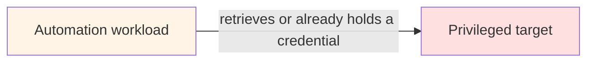

## Trusted Automation Execution

Most privileged automation is trusted for one reason: it has the credentials.

The script lives on the automation server. The server holds a service account. The service account can reach every device in the estate. Whatever runs there runs with that authority, whether it is the version that was reviewed last month, a copy someone edited at 2am, or something that was never reviewed at all.

!!! quote "The central question"
    **Your automation has valid credentials. But should you trust the automation itself?**

Protecting passwords, keys, and tokens is essential, and the [secrets and credentials](../../production-grade-network-automation-principles/secrets-and-credentials-in-enterprise-automation.md) principle covers it. But it answers only one question: *can this workload authenticate?* This architecture asks a different one:

> Why should **this** automation artefact, requested by **this** identity, in **this** context, be permitted to exercise **this** capability against **these** resources — **now**?

!!! warning "What this is, and what it is not"
    This is a reference architecture and an engineering proof of concept — a Nautomation Prime design proposal. It is not a claim of NIST certification, of formal compliance with any framework, or of a finished security product.

---

## The Problem: Authentication Standing In for Trust

A common automation path looks like this:

If holding the credential is the practical gate to execution, **authentication and trust have quietly become the same thing**. A valid credential proves that a principal can authenticate. It proves nothing about whether:

- the artefact running is the approved one, unmodified
- it is running in an acceptable context
- the operation it is about to perform is one it was authorised for
- the target is one it was approved to touch
- this is a time it was approved to act

Trusted Automation Execution replaces that implicit assumption with **explicit trust decisions, made before privilege is exercised**, by something other than the workload being constrained.

---

## Relationship to Zero Trust

None of the underlying principles are new. The composition is.

[NIST SP 800-207](https://csrc.nist.gov/pubs/sp/800/207/final) describes Zero Trust as a move away from implicit trust based on network location or asset ownership, towards a focus on users, assets, and resources, with authentication and authorisation performed before access. It is explicit that Zero Trust is an architectural approach, not a product. [SP 800-207A](https://csrc.nist.gov/pubs/sp/800/207/a/final) extends the same thinking to applications and services, with policy based on application and service identities. CISA's [Zero Trust Maturity Model](https://www.cisa.gov/resources-tools/resources/zero-trust-maturity-model) describes the staged journey — Traditional, Initial, Advanced, Optimal — and counts Applications and Workloads among its pillars.

Trusted Automation Execution applies those principles to the one workload most estates still trust implicitly: their own automation. It does not accept that a script is trusted because it lives on an automation server, runs from a trusted subnet, or ran successfully yesterday.

!!! tip "The framing in one line"
    **Treat the automation workload as a privileged subject.** Require evidence before privilege, constrain what follows, and preserve evidence afterwards.

---

## Ten Invariants

These are what the architecture holds constant. Every profile, from a single hardened runner to a full enterprise deployment, keeps all ten. What changes is how strongly each one is enforced.

| Invariant | Why it exists |
|---|---|
| **No implicit trust** | Location, filename, ownership, and previous success are not substitutes for an explicit decision |
| **Default deny** | Unknown or incomplete evidence must never silently become permission |
| **Verify before privilege** | Powerful authority should not exist before the trust decision, wherever the platform can avoid it |
| **Identity is not capability** | Recognising a workload is not the same as granting it every operation the platform can perform |
| **Enforcement is external** | The workload being constrained must not be able to authorise itself |
| **Least privilege** | The accepted blast radius matches the approved operation and target scope, and no more |
| **Outcome is independently validated** | Permission to run is not evidence that the desired state was achieved |
| **Evidence survives the run** | Operators and auditors must be able to reconstruct both the decision and the result |
| **Trust is revocable** | Approval can be withdrawn without editing every workload |
| **Failures are explicit** | Security and operational failures become machine-readable outcomes, never ambiguous success |

The one that does most of the work is **enforcement is external**. Every other invariant can be implemented weakly and strengthened later. A design in which the workload decides whether it is allowed to run has no boundary to strengthen.

---

## The Model in Eight Sentences

The whole architecture reduces to an ordered sequence. The [reference architecture](./architecture.md) page is organised around it, one section per sentence.

1. **Prove who is asking.**
2. **Prove what will run.**
3. **Prove where it came from.**
4. **Decide whether this operation is allowed against these resources, now.**
5. **Grant only the authority required.**
6. **Execute within constraints.**
7. **Validate independently.**
8. **Prove what happened.**

The order is the point. Steps 1 to 4 complete before any privilege exists. Step 5 creates it. Steps 6 to 8 constrain it, check it, and record it. Most automation today starts at step 5, because the credential is already there, and treats the rest as optional.

Between the Lines

In her 2002 Reith Lectures, and for years afterwards, Onora O&rsquo;Neill argued that &ldquo;more trust&rdquo; is the wrong thing to want. What matters is trust placed well &mdash; given to what has shown itself trustworthy, withheld from what has not &mdash; and placing it well takes evidence, not a feeling.

Everything in this section is an attempt to place trust well in something that cannot earn it the way a colleague does. The reward is not suspicion. It is being able to stop checking &mdash; to go home knowing that what ran overnight was what you approved, and that it can prove it.

---

## Risk, Not Size

The controls change with capability, risk, and maturity. The trust model does not.

Organisation size is deliberately not the axis. A small organisation operating critical infrastructure may need stronger controls than a much larger one running low-impact automation. The [adoption profiles](./adoption-profiles.md) are therefore graded by risk and by the systems you already have, never by headcount.

---

## How It Connects to the Rest of the Foundation

| Existing material | How it relates |
|---|---|
| [Governed Automation Reference Architecture](../../standards/reference-architecture.md) | The estate-level layers. This architecture details the hand-off between the governed service layer, security services, and orchestration for privileged runs |
| [Remediation Packs](../../production-grade-network-automation-principles/remediation-packs.md) | The immutable artefact for a *change*. Trusted Automation Execution applies the same discipline to the *code* that applies it |
| [Automation Risk Classification](../../production-grade-network-automation-principles/enterprise-control-matrix.md#automation-risk-classification) | The R0–R4 classes, used here unchanged to decide what the gateway demands |
| [Governed AI for Network Operations](../../governed-ai-network-operations/index.md) | An AI agent is one more requester, never a privileged exception |
| [Automation Control Catalogue](../../standards/control-catalogue.md) | Most components map to existing `NP-*` controls. The [mapping](./architecture.md#mapping-to-the-control-catalogue) shows where this architecture goes further |

---

## In This Section

1. [The Full Reference Architecture](./architecture.md) — The target state, component by component, with the reason for each
2. [Threat and Failure Model](./threat-and-failure-model.md) — What it defends against, how it behaves when its own parts fail, and what it explicitly does not claim
3. [Adoption Profiles](./adoption-profiles.md) — Four profiles from Foundation to High-Assurance, the control progression between them, and a phased roadmap
4. [Proof of Concept v1](./proof-of-concept.md) — Small enough to build, complete enough to prove the idea, and honest about the difference

---

## Sources

The external work this model draws on. These sources support the principles. The specific composition, the profiles, and the risk-class mapping are Nautomation Prime design proposals, not standards published by these organisations.

- NIST SP 800-207, [Zero Trust Architecture](https://csrc.nist.gov/pubs/sp/800/207/final)
- NIST SP 800-207A, [A Zero Trust Architecture Model for Access Control in Cloud-Native Applications in Multi-Cloud Environments](https://csrc.nist.gov/pubs/sp/800/207/a/final)
- CISA, [Zero Trust Maturity Model, Version 2.0](https://www.cisa.gov/resources-tools/resources/zero-trust-maturity-model)
- NIST CSWP 20, [Planning for a Zero Trust Architecture: A Planning Guide for Federal Administrators](https://nvlpubs.nist.gov/nistpubs/CSWP/NIST.CSWP.20.pdf)
- SLSA, [Provenance](https://slsa.dev/provenance/) and [Build: Verifying artifacts](https://slsa.dev/spec/v1.2/verifying-artifacts)
- SPIFFE, [Overview](https://spiffe.io/docs/latest/spiffe-about/overview/)
- Microsoft, [Implement a privileged access architecture](https://learn.microsoft.com/en-us/security/zero-trust/adopt/implement-privileged-access)
- OWASP, [CI/CD Security Cheat Sheet](https://cheatsheetseries.owasp.org/cheatsheets/CI_CD_Security_Cheat_Sheet.html)

---

## Continue

- Next: [The Full Reference Architecture](./architecture.md)
- Section index: [Reference Architectures](../index.md)
- Related: [Governed Automation Reference Architecture](../../standards/reference-architecture.md) · [Automation Control Catalogue](../../standards/control-catalogue.md)
