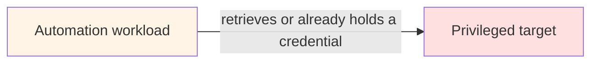
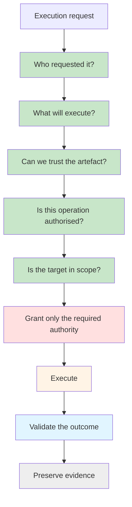
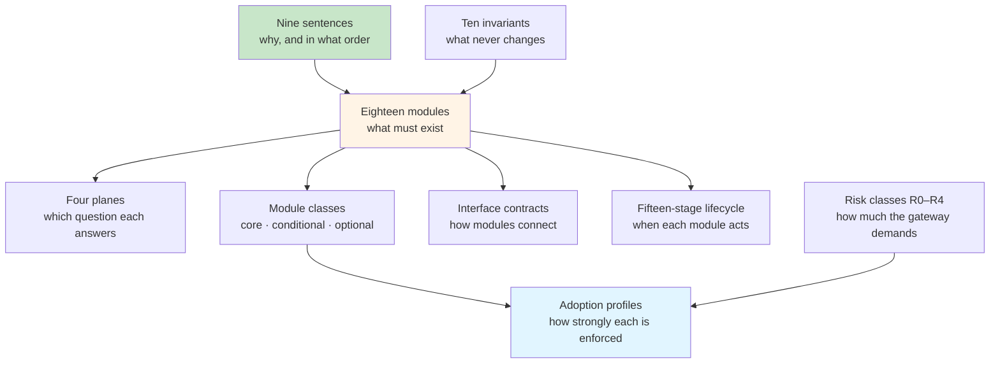

## Trusted Automation Execution

!!! quote "The core proposition"
    **Credentials enable access. They should not, by themselves, establish trust in the automation exercising that access.**

Most privileged automation is trusted for one reason: it has the credentials.

The script lives on the automation server. The server holds a service account. The service account can reach every device in the estate. Whatever runs there runs with that authority, whether it is the version that was reviewed last month, a copy someone edited at 2am, or something that was never reviewed at all.

Protecting passwords, keys, and tokens is essential, and the [secrets and credentials](../../production-grade-network-automation-principles/secrets-and-credentials-in-enterprise-automation.md) principle covers it. But it answers only one question: *can this workload authenticate?* There is another question, and it should be asked first.

!!! question "The central question"
    **Your automation has valid credentials. But should you trust the automation itself?**

Answering it means being able to say:

> Why should **this** automation artefact, requested by **this** identity, in **this** context, be permitted to exercise **this** capability against **these** resources — **now**?

!!! warning "What this is, and what it is not"
    This is a reference architecture and an engineering proof of concept — a Nautomation Prime design proposal, currently at version 2.2 (October 2026). It is not a claim of NIST certification, of formal compliance with any framework, or of a finished security product.

---

## The Problem: Authentication Standing In for Trust

A common automation path looks like this:

If holding the credential is the practical gate to execution, **authentication and trust have quietly become the same thing**. A valid credential proves that a principal can authenticate. It proves nothing about whether:

- the artefact running is the approved one, unmodified
- it is running in an acceptable context
- the operation it is about to perform is one it was authorised for
- the target is one it was approved to touch
- this is a time it was approved to act

Trusted Automation Execution replaces that implicit assumption with **explicit trust decisions, made before privilege is exercised**, by something other than the workload being constrained. The same path, with the trust decision in front of it:

The difference looks small and changes the security model considerably. The credential is no longer the thing that establishes trust. It becomes something the workload is permitted to obtain, or use, **after** trust and authorisation have been established.

---

## Not a Python Problem, and Not Only a Network One

This architecture started with Python-based network automation, and most of the examples on these pages are network examples, because that is what this site is about. But the further the problem is followed, the less the language matters.

The same questions apply to PowerShell, Ansible, Terraform, and Bash; to CI/CD pipelines, cloud automation, containers, and scheduled jobs; to infrastructure agents; and to AI-triggered operations. Any of them can hold authority over a large part of an estate. Any of them can be modified, replaced, or pointed at something it was never meant to touch, while its credential stays perfectly valid.

!!! tip "Where the boundary is"
    **The language is not the security boundary. The privileged execution is.**

Trusted Automation Execution is therefore not "security for Python". It is a security model for privileged automation, whatever it happens to be written in.

---

## Relationship to Zero Trust

None of the underlying principles are new. The composition is.

[NIST SP 800-207](https://csrc.nist.gov/pubs/sp/800/207/final) describes Zero Trust as a move away from implicit trust based on network location or asset ownership, towards a focus on users, assets, and resources, with authentication and authorisation performed before access. It is explicit that Zero Trust is an architectural approach, not a product. [SP 800-207A](https://csrc.nist.gov/pubs/sp/800/207/a/final) extends the same thinking to applications and services, with policy based on application and service identities. CISA's [Zero Trust Maturity Model](https://www.cisa.gov/resources-tools/resources/zero-trust-maturity-model) describes the staged journey — Traditional, Initial, Advanced, Optimal — and counts Applications and Workloads among its pillars.

Trusted Automation Execution applies those principles to the one workload most estates still trust implicitly: their own automation. It does not accept that a script is trusted because it lives on an automation server, runs from a trusted subnet, or ran successfully yesterday.

!!! tip "The framing in one line"
    **Treat the automation workload as a privileged subject.** Require evidence before privilege, constrain what follows, and preserve evidence afterwards.

---

## Ten Invariants

These are what the architecture holds constant. Every profile, from a single hardened runner to a full enterprise deployment, keeps all ten. What changes is how strongly each one is enforced.

| Invariant | Why it exists |
|---|---|
| **No implicit trust** | Location, filename, ownership, and previous success are not substitutes for an explicit decision |
| **Default deny** | Unknown or incomplete evidence must never silently become permission |
| **Verify before privilege** | Powerful authority should not exist before the trust decision, wherever the platform can avoid it |
| **Identity is not capability** | Recognising a workload is not the same as granting it every operation the platform can perform |
| **Enforcement is external** | The workload being constrained must not be able to authorise itself |
| **Least privilege** | The accepted blast radius matches the approved operation and target scope, and no more |
| **Outcome is independently validated** | Permission to run is not evidence that the desired state was achieved |
| **Evidence survives the run** | Operators and auditors must be able to reconstruct both the decision and the result |
| **Trust is revocable** | Approval can be withdrawn without editing every workload |
| **Failures are explicit** | Security and operational failures become machine-readable outcomes, never ambiguous success |

The one that does most of the work is **enforcement is external**. Every other invariant can be implemented weakly and strengthened later. A design in which the workload decides whether it is allowed to run has no boundary to strengthen.

---

## The Model in Nine Sentences

The whole architecture reduces to an ordered sequence. The [reference architecture](./architecture.md) page is organised around it, one section per sentence.

1. **Prove who is asking.**
2. **Prove what will run.**
3. **Establish where it came from.**
4. **Decide what it may do.**
5. **Constrain where it may do it.**
6. **Grant only the authority required.**
7. **Execute within defined boundaries.**
8. **Validate the resulting state independently.**
9. **Prove what happened.**

The order is the point. Steps 1 to 5 complete before any privilege exists. Step 6 creates it. Steps 7 to 9 constrain it, check it, and record it. Most automation today starts at step 6, because the credential is already there, and treats the rest as optional.

The sentences say *why*. The [eighteen modules](./architecture.md#the-module-catalogue) say *what*: each module sits under one sentence, and implements part of it.

Steps 4 and 5 are separate on purpose. *What* a workload may do and *where* it may do it are different questions, and a design that answers only one of them has a gap. A verified compliance workload is still not permitted to reload a device. An approved change workload is still not permitted to touch every device it can reach.

Between the Lines

In her 2002 Reith Lectures, and for years afterwards, Onora O&rsquo;Neill argued that &ldquo;more trust&rdquo; is the wrong thing to want. What matters is trust placed well &mdash; given to what has shown itself trustworthy, withheld from what has not &mdash; and placing it well takes evidence, not a feeling.

Everything in this section is an attempt to place trust well in something that cannot earn it the way a colleague does. The reward is not suspicion. It is being able to stop checking &mdash; to go home knowing that what ran overnight was what you approved, and that it can prove it.

---

## Modular by Design

!!! quote "The design principle"
    **The security properties are mandatory. The products implementing them are replaceable.**

The architecture is eighteen modules, each named for what it must establish rather than for a product, and joined to the next by a contract rather than by a product. That is what makes it usable in an estate that already owns a stack, and what lets the stack change without the architecture changing:

- **Swap** any module's product, as long as the replacement honours the same contract — the same inputs, outputs, policy, and evidence. Nothing on either side of it has to change.
- **Omit** a conditional module while the situation that requires it does not apply. A genuinely secretless path needs no vault retrieval. A read-only audit may need no change approval.
- **Remove** an optional module entirely — a separate source of truth, an orchestrator, a device AAA platform — and record what that does to assurance.

What you cannot remove is a core module, or any of the ten invariants. Replaceable is not removable.

The modules fall into four planes, each answering one question:

| Plane | Question |
|---|---|
| **Control** | Should this happen? |
| **Execution** | How can it happen safely? |
| **Validation** | Did reality become the approved intent? |
| **Observability and evidence** | Can we prove what happened? |

The [full reference architecture](./architecture.md#modular-by-design) has the module catalogue, the class of every module, and the conformance rule. The [interface contracts](./interface-contracts.md) define what passes between modules, which is what makes a swap safe.

---

## How the Ideas Fit Together

The model has several lists in it. They are one model, seen from different sides.

| Idea | The question it answers |
|---|---|
| **Nine sentences** | Why, and in what order trust is established |
| **Ten invariants** | What never changes, whatever the implementation |
| **Eighteen modules** | What must exist |
| **Four planes** | Which question each module answers |
| **Module classes** | What can be omitted or removed, and on what condition |
| **Interface contracts** | How modules connect, so any one can be replaced |
| **Fifteen-stage lifecycle** | When each module acts during a run |
| **Adoption profiles** | How strongly each module is enforced |
| **Risk classes** | How much the gateway demands for a given workload |

### Where to start reading

| You are… | Read, in this order |
|---|---|
| **A network engineer with automation to protect** | [Foundation Quick-Start](./foundation-quick-start.md) · [Proof of Concept](./proof-of-concept.md) · [Interface Contracts](./interface-contracts.md) |
| **An architect designing an implementation** | [The Full Reference Architecture](./architecture.md) · [Interface Contracts](./interface-contracts.md) · [Threat and Failure Model](./threat-and-failure-model.md) · [Worked Example](./worked-example-azure-cisco.md) |
| **A leader, manager, or auditor** | This page · [Adoption Profiles](./adoption-profiles.md) · [Operating Model](./operating-model.md) · [Threat and Failure Model](./threat-and-failure-model.md) |

---

## Risk, Not Size

The controls change with capability, risk, and maturity. The trust model does not.

Organisation size is deliberately not the axis. A small organisation operating critical infrastructure may need stronger controls than a much larger one running low-impact automation. The [adoption profiles](./adoption-profiles.md) are therefore graded by risk and by the systems you already have, never by headcount.

---

## How It Connects to the Rest of the Academy

| Existing material | How it relates |
|---|---|
| [Governed Automation Reference Architecture](../../standards/reference-architecture.md) | The estate-level layers. This architecture details the hand-off between the governed service layer, security services, and orchestration for privileged runs |
| [Remediation Packs](../../production-grade-network-automation-principles/remediation-packs.md) | The immutable artefact for a *change*. Trusted Automation Execution applies the same discipline to the *code* that applies it |
| [Automation Risk Classification](../../production-grade-network-automation-principles/enterprise-control-matrix.md#automation-risk-classification) | The R0–R4 classes, used here unchanged to decide what the gateway demands |
| [Governed AI for Network Operations](../../governed-ai-network-operations/index.md) | An AI agent is one more requester, never a privileged exception |
| [Automation Control Catalogue](../../standards/control-catalogue.md) | Most components map to existing `NP-*` controls. The [mapping](./architecture.md#mapping-to-the-control-catalogue) shows where this architecture goes further |

---

## In This Section

1. [The Full Reference Architecture](./architecture.md) — The target state, module by module: eighteen modules across four planes, with the reason for each and what can be swapped or removed
2. [Interface Contracts](./interface-contracts.md) — The eight contracts between modules, defined language-neutrally, and the tests a replacement module has to pass
3. [Threat and Failure Model](./threat-and-failure-model.md) — What it defends against, how it behaves when its own parts fail, and what it explicitly does not claim
4. [Adoption Profiles](./adoption-profiles.md) — Four profiles from Foundation to High-Assurance, the control progression between them, and a phased roadmap
5. [Foundation Quick-Start](./foundation-quick-start.md) — Six steps, in order, for a small team, each with a test that tells you it is done
6. [Operating Model](./operating-model.md) — Who owns each module, how workloads are onboarded and retired, policy as code, running the gateway at scale, and what to measure
7. [Worked Example: Azure and Cisco](./worked-example-azure-cisco.md) — Full adoption on one illustrative stack, with alternatives for every module, what changes when modules are swapped or removed, and the gaps no product closes
8. [Proof of Concept v1](./proof-of-concept.md) — Small enough to build, complete enough to prove the idea, and honest about the difference. A specification; no code is published

---

## Sources

The external work this model draws on. These sources support the principles. The specific composition, the profiles, and the risk-class mapping are Nautomation Prime design proposals, not standards published by these organisations.

- NIST SP 800-207, [Zero Trust Architecture](https://csrc.nist.gov/pubs/sp/800/207/final)
- NIST SP 800-207A, [A Zero Trust Architecture Model for Access Control in Cloud-Native Applications in Multi-Cloud Environments](https://csrc.nist.gov/pubs/sp/800/207/a/final)
- CISA, [Zero Trust Maturity Model, Version 2.0](https://www.cisa.gov/resources-tools/resources/zero-trust-maturity-model)
- NIST CSWP 20, [Planning for a Zero Trust Architecture: A Planning Guide for Federal Administrators](https://nvlpubs.nist.gov/nistpubs/CSWP/NIST.CSWP.20.pdf)
- SLSA, [Provenance](https://slsa.dev/provenance/) and [Build: Verifying artifacts](https://slsa.dev/spec/v1.2/verifying-artifacts)
- SPIFFE, [Overview](https://spiffe.io/docs/latest/spiffe-about/overview/)
- Microsoft, [Implement a privileged access architecture](https://learn.microsoft.com/en-us/security/zero-trust/adopt/implement-privileged-access)
- OWASP, [CI/CD Security Cheat Sheet](https://cheatsheetseries.owasp.org/cheatsheets/CI_CD_Security_Cheat_Sheet.html)

---

## Continue

- Next: [The Full Reference Architecture](./architecture.md)
- Section index: [Reference Architectures](../index.md)
- Related: [Governed Automation Reference Architecture](../../standards/reference-architecture.md) · [Automation Control Catalogue](../../standards/control-catalogue.md)
