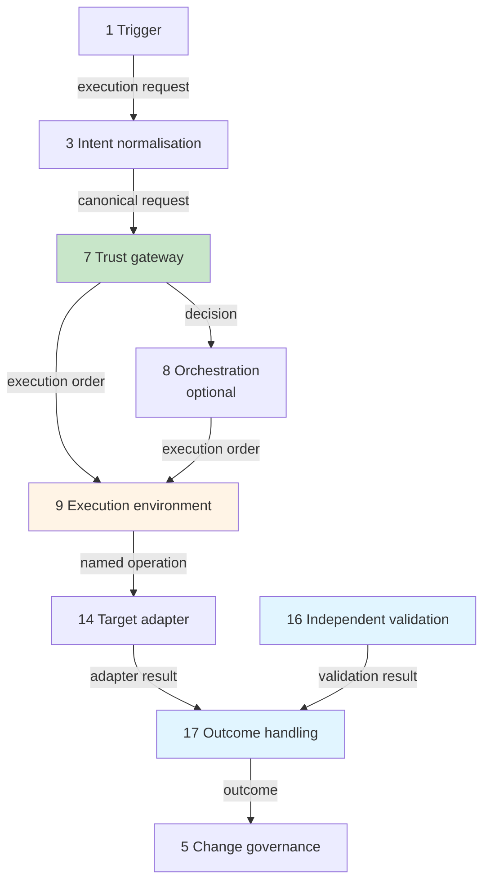

## Interface Contracts

The architecture is [modular](./architecture.md#modular-by-design) because its modules depend on contracts, not on each other. A trust gateway does not care whether the request came from ServiceNow or a webhook; it cares that it received a valid canonical request. A validator does not care which adapter made the change; it returns a result in a known shape. Keep the contracts stable and every module behind them can be rebuilt, replaced, or written in a different language without anything else noticing.

This page defines those contracts. It is the part of the architecture you implement against.

!!! info "Specification, not code"
    Each contract is described as a field table with an illustrative JSON example. Nothing here is a library, a schema file, or a reference implementation, and nothing should be read as one. Python, Go, PowerShell, or anything else can satisfy these contracts equally well. The field names are a minimum: extend them, but do not rename them, because the names are what let a replacement module fit.

---

## Where the Contracts Sit

Eight contracts carry a run from request to evidence.

| Contract | Produced by (module) | Consumed by (module) | Lifecycle stage |
|---|---|---|---|
| **[Execution request](#1-execution-request)** | Request / trigger (1) | Intent normalisation (3) | 1 |
| **[Canonical request](#2-canonical-request)** | Intent normalisation (3) | Trust gateway (7) | 1–6 |
| **[Decision](#3-decision)** | Trust gateway (7) | Orchestration (8), execution environment (9), change governance (5) on escalation | 6 |
| **[Execution order](#4-execution-order)** | Trust gateway (7), or orchestration (8) on its behalf | Execution environment (9) | 8 |
| **[Operation declaration and adapter result](#5-operation-declaration-and-adapter-result)** | Workload manifest (6); target adapter (14) | Trust gateway (7), outcome handling (17) | 3, 10 |
| **[Validation result](#6-validation-result)** | Independent validation (16) | Outcome handling (17) | 11 |
| **[Outcome](#7-outcome)** | Outcome handling (17) | Change governance (5), evidence (18) | 12 |
| **[Evidence event](#8-evidence-event)** | Every module | Observability and evidence (18) | All |



Every module on the diagram also emits evidence events to module 18. Those arrows are left off to keep it readable.

---

## Rules for Every Contract

These apply to all eight. They are what make the contracts safe to cross a trust boundary.

| Rule | Why |
|---|---|
| **Every message carries `contract` and `contract_version`** | A consumer must know exactly what it is parsing. Versions follow major.minor: a consumer accepts any minor version of the major it supports, and refuses a major it does not |
| **Every message after acceptance carries `job_id`** | The Job ID is the thread that ties the run together. A message without one cannot be correlated, so it cannot be trusted |
| **Strict at trust boundaries** | The execution request, canonical request, decision, and execution order reject unknown top-level fields and missing required ones. Extra data goes in an `extensions` object, which policy ignores unless a rule names it. A field nobody expected is a field somebody may have smuggled |
| **Identity comes from authentication, never from the payload** | A `requester` field in a submitted request is ignored. The request service takes the requester from the authenticated session or the verified event identity |
| **Times are UTC, in ISO 8601** | Correlation across platforms fails on mixed time zones |
| **Enumerations are fixed and upper case** | `ALLOW`, not `allowed` or `Allow`. A consumer that meets a value it does not recognise treats it as the most restrictive one available |
| **No secrets, ever** | Contracts carry references to credentials — a secret's name or an issuance identifier — never the credential itself |
| **Integrity in transit** | Between hosts, messages travel over mutually authenticated channels. A decision consumed by a separate execution environment is also signed by the gateway, so the executor can verify it did not come from somewhere else |

The Foundation profile can meet these with files and a single host: a local queue, file permissions instead of mutual TLS, and the runner reading its own decision. The rules do not change with the profile. Their implementation does.

---

## 1. Execution request

What a caller submits. It is deliberately small, because it is untrusted input.

| Field | Required | Meaning |
|---|---|---|
| `contract`, `contract_version` | Yes | `execution-request`, and its version |
| `client_request_id` | Yes | The caller's own identifier, used to make submission idempotent: the same ID twice is one request, not two |
| `workload` | Yes | `name` and `digest`. A release is always named by digest, never by tag or path |
| `operation` | Yes | The named operation from the workload's manifest |
| `targets` | Yes | The targets as the caller names them. They are resolved later, by the gateway, from an authoritative source |
| `parameters` | No | Operation-specific values, validated against the operation's declared parameters |
| `change_id` | Conditional | Required where policy requires a change record |
| `requested_window` | No | `start` and `end`, if the caller wants the run held to a window |
| `channel` | Yes | Which entry route was used: `ITSM`, `API`, `PIPELINE`, `SCHEDULER`, `AGENT` |

```json
{
  "contract": "execution-request",
  "contract_version": "1.0",
  "client_request_id": "c0f3d1e2-5a77-4b0e-9a51-2f4c0e8d1b6a",
  "workload": {
    "name": "access-port-vlan",
    "digest": "sha256:9f2c…"
  },
  "operation": "set-access-vlan",
  "targets": ["switch-a", "switch-b"],
  "parameters": { "interface": "GigabitEthernet1/0/12", "vlan": 120 },
  "change_id": "CHG0001234",
  "channel": "ITSM"
}
```

There is no requester field. Who asked is established by authentication, not by what the request says about itself.

---

## 2. Canonical request

What the request service produces, and the only request format the gateway accepts. Downstream modules depend on this contract and never on the trigger's own format.

| Field | Required | Meaning |
|---|---|---|
| `contract`, `contract_version` | Yes | `canonical-request`, and its version |
| `job_id` | Yes | Issued here, at acceptance. Globally unique |
| `accepted_at` | Yes | When the request service accepted it |
| `requester` | Yes | `principal`, `type` (`HUMAN`, `SERVICE`, `SCHEDULER`, `AGENT`), and `auth_context` — for example, whether MFA was used and whether a privileged role was active |
| `channel` | Yes | Copied from the execution request |
| `workload` | Yes | `name`, `version`, and `digest` |
| `operation` | Yes | A value from the operation taxonomy |
| `capability_requested` | Yes | The capability the operation needs, from the manifest |
| `risk_class` | Yes | `R0` to `R4`, from the operation. The gateway re-derives it and never trusts this value alone |
| `targets` | Yes | Each target as requested. The `resolved` part is empty here, and filled in by the gateway at stage 5 |
| `parameters` | No | Validated parameters |
| `change_id` | Conditional | As supplied, if any |
| `window` | No | The permitted window, if any |

```json
{
  "contract": "canonical-request",
  "contract_version": "1.0",
  "job_id": "job-01J9Z6Q8T4V2K7M3N5P8R1S6W0",
  "accepted_at": "2026-10-31T09:14:05Z",
  "requester": {
    "principal": "engineer@example.org",
    "type": "HUMAN",
    "auth_context": { "mfa": true, "privileged_role_active": true }
  },
  "channel": "ITSM",
  "workload": {
    "name": "access-port-vlan",
    "version": "2.3.0",
    "digest": "sha256:9f2c…"
  },
  "operation": "set-access-vlan",
  "capability_requested": "config-write:access-interface",
  "risk_class": "R3",
  "targets": [
    { "requested": "switch-a", "resolved": null },
    { "requested": "switch-b", "resolved": null }
  ],
  "parameters": { "interface": "GigabitEthernet1/0/12", "vlan": 120 },
  "change_id": "CHG0001234"
}
```

A request that fails validation here never reaches the gateway. It ends in the `REJECTED` [outcome](#7-outcome), with an evidence event recording why.

---

## 3. Decision

What the trust gateway returns. A decision is a record, not a flag: it says what was decided, why, under which policy, and under what constraints.

| Field | Required | Meaning |
|---|---|---|
| `contract`, `contract_version` | Yes | `decision`, and its version |
| `job_id` | Yes | The request this decision belongs to |
| `decision_id` | Yes | Unique. An execution environment accepts each decision once |
| `decision` | Yes | `ALLOW`, `DENY`, or `ESCALATE` |
| `reason_codes` | Yes | Why. At least one, for every result, including `ALLOW` |
| `policy_version` | Yes | The policy as it stood when it decided |
| `evaluated_at`, `expires_at` | Yes | An `ALLOW` that is not used before `expires_at` is void |
| `bound_to` | Yes | The `workload_digest` and `operation` this decision applies to. An executor that would run anything else refuses |
| `constraints` | For `ALLOW` | `capability_authorised`, the resolved `targets`, and limits such as `max_concurrency`, `batch_size`, and `deadline` |
| `escalation` | For `ESCALATE` | Where the request went for a human decision, and the change record it is waiting on |

```json
{
  "contract": "decision",
  "contract_version": "1.0",
  "job_id": "job-01J9Z6Q8T4V2K7M3N5P8R1S6W0",
  "decision_id": "dec-7c41e0b2",
  "decision": "ALLOW",
  "reason_codes": ["POLICY_SATISFIED", "APPROVAL_VALID"],
  "policy_version": "policy-bundle-2026.10.31-3",
  "evaluated_at": "2026-10-31T09:14:07Z",
  "expires_at": "2026-10-31T09:24:07Z",
  "bound_to": {
    "workload_digest": "sha256:9f2c…",
    "operation": "set-access-vlan"
  },
  "constraints": {
    "capability_authorised": "config-write:access-interface",
    "targets": [
      { "requested": "switch-a", "resolved": "dcim:device:4411" },
      { "requested": "switch-b", "resolved": "dcim:device:4412" }
    ],
    "max_concurrency": 1,
    "batch_size": 1,
    "deadline": "2026-10-31T10:00:00Z"
  }
}
```

### Reason codes

A starting set. Extend it, but keep each code specific enough that a denial can be acted on without reading the gateway's logs.

| Code | Result | Meaning |
|---|---|---|
| `POLICY_SATISFIED` | ALLOW | Every rule that applies was met |
| `APPROVAL_VALID` | ALLOW | A required approval exists, matches the digest and scope, and has not expired |
| `UNKNOWN_WORKLOAD` | DENY | No registered workload has this name and digest |
| `INTEGRITY_MISMATCH` | DENY | The digest does not match the approved release |
| `SIGNATURE_INVALID` | DENY | The signature is missing, or not from a trusted publisher |
| `PROVENANCE_UNVERIFIED` | DENY | Provenance is missing, or does not match the expected builder and inputs |
| `REVOKED` | DENY | The workload version, publisher, requester, or grant has been withdrawn |
| `REQUESTER_NOT_AUTHORISED` | DENY | This principal may not request this workload or operation |
| `CAPABILITY_NOT_GRANTED` | DENY | The operation needs a capability the workload's grant does not include |
| `TARGET_UNRESOLVED` | DENY | A requested target has no authoritative record |
| `TARGET_OUT_OF_SCOPE` | DENY | A target resolved, but is outside the grant's scope |
| `CONTEXT_MISSING` | DENY | A mandatory input could not be obtained |
| `CONTEXT_STALE` | DENY | A mandatory input is older than its freshness limit |
| `CONTEXT_CONFLICT` | DENY | Authoritative sources disagree about a target |
| `OUTSIDE_WINDOW` | DENY | The run falls outside its permitted window |
| `APPROVAL_INVALID` | DENY | An approval exists but does not match, or has been withdrawn |
| `EVIDENCE_UNAVAILABLE` | DENY | Policy requires evidence to be committed, and the evidence platform is not accepting it |
| `APPROVAL_REQUIRED` | ESCALATE | A human decision is needed and has not yet been given |

---

## 4. Execution order

What the execution environment receives. It never runs anything without one, and it checks the order against the decision before it starts.

| Field | Required | Meaning |
|---|---|---|
| `contract`, `contract_version` | Yes | `execution-order`, and its version |
| `job_id`, `decision_id` | Yes | The run and the decision that authorised it |
| `workload_digest` | Yes | What to start. The environment verifies the artefact's signature itself before starting it |
| `operation`, `parameters` | Yes | The named operation and its validated parameters |
| `targets` | Yes | Resolved targets only, with the management address each one should be reached on |
| `constraints` | Yes | Copied from the decision |
| `credential_reference` | Conditional | The name of the credential the workload may retrieve with its own identity. Never the credential |
| `validation_profile` | Yes | Which validation the run will be judged by |
| `issued_at` | Yes | When the order was issued |
| `signature` | Between hosts | The gateway's signature over the order |

```json
{
  "contract": "execution-order",
  "contract_version": "1.0",
  "job_id": "job-01J9Z6Q8T4V2K7M3N5P8R1S6W0",
  "decision_id": "dec-7c41e0b2",
  "workload_digest": "sha256:9f2c…",
  "operation": "set-access-vlan",
  "parameters": { "interface": "GigabitEthernet1/0/12", "vlan": 120 },
  "targets": [
    { "id": "dcim:device:4411", "management_address": "192.0.2.11" },
    { "id": "dcim:device:4412", "management_address": "192.0.2.12" }
  ],
  "constraints": { "max_concurrency": 1, "batch_size": 1, "deadline": "2026-10-31T10:00:00Z" },
  "credential_reference": "automation/access-port-vlan/device",
  "validation_profile": "access-port-vlan-v2",
  "issued_at": "2026-10-31T09:14:09Z"
}
```

The execution environment refuses the order if the decision is not `ALLOW`, has expired, has already been used, or is bound to a different digest or operation. An orchestrator can pass an order on. It cannot create one.

---

## 5. Operation declaration and adapter result

Two halves of one contract. The **operation declaration** lives in the workload's signed manifest and says what an operation is allowed to be. The **adapter result** is what each target reports back after the operation ran.

### Operation declaration

| Field | Required | Meaning |
|---|---|---|
| `name`, `version` | Yes | The operation, as named in requests |
| `capability` | Yes | The capability it needs |
| `risk_class` | Yes | `R0` to `R4` |
| `platforms` | Yes | The target platforms it supports |
| `parameters` | Yes | Each parameter's name, type, and allowed values |
| `preflight` | Yes | The checks that must pass before any write |
| `safeguards` | Yes | For example, whether a confirmed commit is used and whether a dry run is supported |
| `rollback` | Yes | `safe` (`true` or `false`) and `method`. Declared before any run, because automatic rollback is not universal |
| `validation_profile` | Yes | How the result will be judged |

```json
{
  "name": "set-access-vlan",
  "version": "2.3.0",
  "capability": "config-write:access-interface",
  "risk_class": "R3",
  "platforms": ["cisco-iosxe"],
  "parameters": {
    "interface": { "type": "string", "pattern": "^GigabitEthernet[0-9/]+$" },
    "vlan": { "type": "integer", "minimum": 2, "maximum": 4094 }
  },
  "preflight": ["identity-matches-sot", "interface-is-access-mode", "vlan-exists"],
  "safeguards": { "confirmed_commit": true, "dry_run": true },
  "rollback": { "safe": true, "method": "confirmed-commit-revert" },
  "validation_profile": "access-port-vlan-v2"
}
```

### Adapter result

| Field | Required | Meaning |
|---|---|---|
| `job_id`, `target` | Yes | Which run, which target |
| `status` | Yes | `APPLIED`, `NOT_APPLIED`, `FAILED`, or `SKIPPED_PREFLIGHT` |
| `started_at`, `ended_at` | Yes | Timing |
| `change_markers` | No | Platform evidence of the change — a commit identifier, a revert timer, a Job ID marker on the device |
| `error_code` | On failure | A specific, machine-readable reason |

```json
{
  "job_id": "job-01J9Z6Q8T4V2K7M3N5P8R1S6W0",
  "target": "dcim:device:4411",
  "status": "APPLIED",
  "started_at": "2026-10-31T09:15:02Z",
  "ended_at": "2026-10-31T09:15:09Z",
  "change_markers": { "confirm_timer_seconds": 300, "job_marker": "job-01J9Z6Q8T4V2K7M3N5P8R1S6W0" }
}
```

`APPLIED` means the adapter believes the change went in. It is not success. Only the validation result decides that.

---

## 6. Validation result

What the independent validator returns. It is produced by a different identity and different code from the change, and its result is the only one that decides whether the run worked.

| Field | Required | Meaning |
|---|---|---|
| `contract`, `contract_version` | Yes | `validation-result`, and its version |
| `job_id` | Yes | The run being judged |
| `validator` | Yes | `name`, `version`, and the identity it ran as |
| `observed_at` | Yes | When state was collected |
| `result` | Yes | The overall result, aggregated from the targets as below |
| `targets` | Yes | Per target: its `result`, and each `check` with its `expected` value, a summary of what was `observed`, and whether it passed |

```json
{
  "contract": "validation-result",
  "contract_version": "1.0",
  "job_id": "job-01J9Z6Q8T4V2K7M3N5P8R1S6W0",
  "validator": { "name": "access-port-validator", "version": "1.4.1", "identity": "validator-access-port" },
  "observed_at": "2026-10-31T09:16:30Z",
  "result": "PARTIAL",
  "targets": [
    {
      "target": "dcim:device:4411",
      "result": "PASS",
      "checks": [{ "check": "access-vlan", "expected": "120", "observed": "120", "passed": true }]
    },
    {
      "target": "dcim:device:4412",
      "result": "UNKNOWN",
      "checks": [{ "check": "access-vlan", "expected": "120", "observed": "unreachable", "passed": false }]
    }
  ]
}
```

### The five results

| Result | For one target | Overall, across targets |
|---|---|---|
| **PASS** | Every check matches the approved intent | Every target passed |
| **FAIL** | At least one check contradicts the intent | No target passed, and at least one failed |
| **DRIFT** | The state differs from intent in ways this change did not cause | No target passed or failed, and at least one drifted |
| **UNKNOWN** | The state could not be observed | Nothing could be observed on any target |
| **PARTIAL** | — | Some targets passed and others did not |

UNKNOWN never counts as a pass. A validator that could not see the result has not reported success; it has reported that success cannot be claimed.

---

## 7. Outcome

What outcome handling records as the run's terminal state. Every run ends in exactly one of these, including runs that never started.

| Outcome | When | Attention required |
|---|---|---|
| **REJECTED** | The request failed validation at intent normalisation | No |
| **DENIED** | The gateway returned `DENY` | Depends on the reason code; repeated denials are worth investigating |
| **EXPIRED** | An `ESCALATE` was never answered, or an `ALLOW` was never used | No |
| **FAILED_TO_START** | Privilege could not be acquired, the execution environment refused the order, or every target failed pre-flight | Yes |
| **SUCCEEDED** | Validation returned PASS | No |
| **ROLLED_BACK** | Validation returned FAIL or UNKNOWN, the operation declares rollback safe, and the rollback was confirmed | Yes |
| **HALTED** | Validation returned FAIL or UNKNOWN and rollback is not declared safe or did not complete; or the result was DRIFT or PARTIAL | Yes, with escalation |
| **STOPPED** | A revocation, emergency stop, or circuit breaker ended the run | Yes |

| Field | Required | Meaning |
|---|---|---|
| `contract`, `contract_version` | Yes | `outcome`, and its version |
| `job_id` | Yes | The run |
| `outcome` | Yes | One of the eight above |
| `attention_required` | Yes | `true` or `false` |
| `validation_result` | Where validation ran | The overall result it was based on |
| `rollback` | Where attempted | What was rolled back, by which method, and whether it was confirmed |
| `escalated_to` | For `HALTED` | Where the run was escalated |
| `change_id` | Where one applies | So the change record can be updated |
| `completed_at` | Yes | When the terminal state was reached |

```json
{
  "contract": "outcome",
  "contract_version": "1.0",
  "job_id": "job-01J9Z6Q8T4V2K7M3N5P8R1S6W0",
  "outcome": "HALTED",
  "attention_required": true,
  "validation_result": "PARTIAL",
  "rollback": { "attempted": false, "reason": "PARTIAL results halt the batch for review" },
  "escalated_to": "network-change-review",
  "change_id": "CHG0001234",
  "completed_at": "2026-10-31T09:17:02Z"
}
```

DRIFT halts rather than rolling back on purpose. A rollback undoes *this* change. Drift is a difference this change did not make, and undoing the change would not fix it.

---

## 8. Evidence event

What every module emits, all the way through the run. An evidence event is an envelope with a payload: the envelope is the same for every event, and the payload depends on the event type.

| Field | Required | Meaning |
|---|---|---|
| `contract`, `contract_version` | Yes | `evidence-event`, and its version |
| `event_id` | Yes | Unique |
| `event_type` | Yes | From the list below |
| `job_id` | Yes, once issued | The correlation thread. Events from before acceptance carry the `client_request_id` instead |
| `sequence` | Yes | The event's position within its job, so the run can be replayed in order even if events arrive out of order |
| `timestamp` | Yes | When the event happened, from a synchronised clock |
| `emitter` | Yes | The `component`, its `version`, and the `identity` it ran as |
| `payload` | Yes | The event's own fields. For most types, this is the contract message it refers to |
| `previous_event_hash` | Recommended | A hash of the job's previous event, so a deleted or altered event breaks the chain visibly |

```json
{
  "contract": "evidence-event",
  "contract_version": "1.0",
  "event_id": "evt-5b9e2c11",
  "event_type": "decision.allow",
  "job_id": "job-01J9Z6Q8T4V2K7M3N5P8R1S6W0",
  "sequence": 4,
  "timestamp": "2026-10-31T09:14:07Z",
  "emitter": { "component": "trust-gateway", "version": "3.2.0", "identity": "gateway-prod" },
  "payload": { "decision_id": "dec-7c41e0b2", "reason_codes": ["POLICY_SATISFIED", "APPROVAL_VALID"], "policy_version": "policy-bundle-2026.10.31-3" },
  "previous_event_hash": "sha256:1d0a…"
}
```

### Event types

| Event type | Emitted by | When |
|---|---|---|
| `request.accepted`, `request.rejected` | Intent normalisation | Stage 1 |
| `decision.allow`, `decision.deny`, `decision.escalate` | Trust gateway | Stage 6 |
| `privilege.issued`, `privilege.closed` | Trust gateway or secrets broker | Stages 7 and 13 |
| `execution.started`, `execution.refused` | Execution environment | Stage 8 |
| `preflight.result` | Execution environment or adapter | Stage 9 |
| `adapter.result` | Target adapter | Stage 10, once per target |
| `validation.result` | Independent validation | Stage 11 |
| `outcome.final` | Outcome handling | Stage 12 |
| `revocation.applied`, `breakglass.used` | Gateway, or the platform where it happened | Whenever they happen |

The evidence platform stores events append-only. Nothing in a run can update or delete an event that has been committed; a correction is a new event that refers to the old one.

!!! warning "Evidence safety"
    Record credential references, authorisation decisions, and retrieval outcomes. Never record passwords, secret values, private keys, session cookies, or access and refresh tokens, in any field of any event.

---

## Proving a Replacement Fits

A contract is only useful if a replacement module can be shown to honour it. So every module implementation comes with contract tests, and a swap is accepted when the new module passes the same ones as the old.

| For a replacement… | It must show |
|---|---|
| **Request service** | Valid requests produce canonical requests with a Job ID; a request with an unknown field, a missing field, or a payload-supplied requester is rejected |
| **Trust gateway or decision engine** | The same inputs and policy version produce the same decision; every result carries reason codes; missing mandatory context produces `DENY`; decisions expire and cannot be reused |
| **Execution environment** | It refuses orders with no decision, an expired or reused decision, or a decision bound to a different digest or operation; it verifies the artefact itself |
| **Adapter** | It accepts only declared operations and parameters within their declared limits, and reports every target, including those it skipped |
| **Validator** | It aggregates per-target results into the overall result exactly as defined above, and returns UNKNOWN — not PASS — when it cannot observe |
| **Outcome handler** | Every combination of validation result and rollback declaration maps to the outcome defined above |
| **Evidence backend** | It accepts the same events unchanged, preserves their order by sequence, and can return a complete run from one Job ID |

The tests are written against the contract, not against the product. That is what makes them reusable: the decision-engine tests written when the gateway used one policy engine are the same tests a different engine has to pass.

---

## Continue

- Previous: [The Full Reference Architecture](./architecture.md)
- Next: [Threat and Failure Model](./threat-and-failure-model.md)
- Section index: [Trusted Automation Execution](./index.md)
