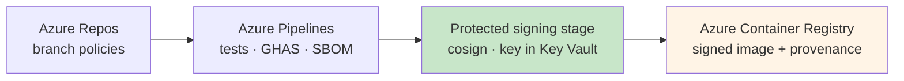
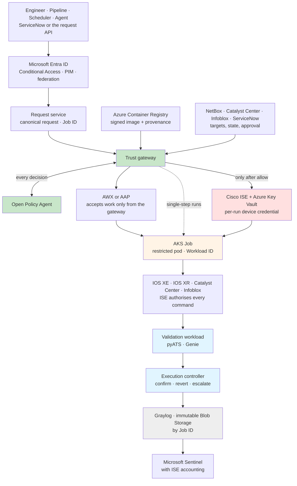

## Worked Example: Azure and Cisco

The rest of this section names responsibilities, not products. This page does the opposite, once. It takes one common stack and shows what Trusted Automation Execution looks like on it at full adoption, with all eighteen modules of the [reference architecture](./architecture.md) in place:

- **ServiceNow** for requests, change, and business CMDB data
- **Microsoft Entra ID and Azure** for identity, secrets, build, hosting, and platform logs
- **NetBox, Cisco Catalyst Center, and Infoblox** for target context
- **AWX or Ansible Automation Platform** for orchestration, behind the gateway
- **Cisco ISE, IOS XE, and IOS XR** on the network side, and **Graylog** for evidence

Three things are worth looking for as you read. The first is how much of the architecture existing products already provide. The second, and more useful, is where they stop: the places where no product on the list does the job, and you have to build or configure something deliberately. The third is the [modularity](./architecture.md#modular-by-design): every product here sits behind a module's contract, so any row can be swapped for its alternative, and the optional ones removed, without the rest of the stack noticing.

!!! note "Illustrative, not a deployment"
    This describes no real organisation's environment. It is one possible mapping, chosen because these products are common in enterprise networks, and every module lists alternatives. Topology, naming, and policy values are deliberately absent: they are yours to decide, and they are the parts that would make a design like this sensitive. Like the [proof of concept](./proof-of-concept.md), this is a design. No code, templates, or configuration are published with it.

    Product names are trademarks of their respective owners, as acknowledged in the [Terms of Use](../../../legal/terms-of-use.md#trademarks). Naming them here is descriptive and implies no affiliation with, or endorsement by, any vendor.

---

## The Stack at a Glance

| Module | In this example | Alternatives |
|---|---|---|
| **1. Request / Trigger** ● | ServiceNow catalogue items and change requests, and a request API on the gateway; Azure Pipelines calls the same API for pipeline-initiated work | A portal, webhooks, a scheduler with its own identity, Git events |
| **2. Requester identity** ◆ | Microsoft Entra ID, with Conditional Access and Privileged Identity Management (PIM); workload identity federation for Azure Pipelines | Okta, Ping Identity |
| **3. Intent normalisation** ● | A purpose-built request service that validates every request against the canonical schema and issues the Job ID | The same function inside the gateway |
| **4. Source of truth** ○ | NetBox for network intent, Catalyst Center for observed inventory, Infoblox for addressing and DNS, and the ServiceNow CMDB for ownership and criticality | Nautobot, Infrahub; another IPAM; reviewed Git and YAML |
| **5. Change governance** ◆ | ServiceNow change management; Azure Pipelines environment approvals for pipeline-initiated work | Jira Service Management; approval nodes in Ansible Automation Platform; Git pull requests |
| **6. Artefact trust** ● | Azure Repos with branch policies; Azure Pipelines on ephemeral agents with GitHub Advanced Security for Azure DevOps; Azure Container Registry (ACR); cosign, with signing keys in Azure Key Vault; signed provenance and an SBOM on each image | GitHub or GitLab; Harbor, JFrog Artifactory; Notation, GitHub artifact attestations |
| **7. Trust gateway** ● | A purpose-built service, with Open Policy Agent (OPA) as its decision engine | Cedar, or another engine that meets the same decision contract |
| **8. Orchestration** ○ | AWX, or Ansible Automation Platform (AAP), behind the gateway | Azure Pipelines; none, with the gateway dispatching directly |
| **9. Controlled execution environment** ● | Azure Kubernetes Service (AKS): each run a Kubernetes Job under the restricted Pod Security profile, admitted only if its image is signed. Posture from Azure Policy and Microsoft Defender for Containers | On-premises: Azure Arc-enabled RHEL with rootless Podman, an Arc-enabled cluster such as Red Hat OpenShift, or AAP execution environments (see the [on-premises variant](#variant-on-premises-execution)) |
| **10. Workload identity** ◆ | Microsoft Entra Workload ID, one federated credential per workload service account | SPIFFE identities issued by SPIRE, for identities that do not depend on the platform; Entra managed identities, where one identity per host is acceptable |
| **11. Secret / PKI broker** ◆ | Azure Key Vault, reached only through a private endpoint | HashiCorp Vault, CyberArk, an enterprise PKI |
| **12. Network boundary** ● | Default-deny Kubernetes network policies, network security groups and Azure Firewall on the cluster's egress, and management-plane restrictions on every device | Your firewalls, ACLs, and VRFs |
| **13. Device AAA** ○ | Cisco Identity Services Engine (ISE), TACACS+ device administration | Aruba ClearPass, tac_plus-ng; local device RBAC as a lower-assurance compensating control |
| **14. Target adapter** ● | A Python adapter framework: Netmiko or Scrapli for the CLI, ncclient for NETCONF, and the Catalyst Center and Infoblox APIs | NAPALM, Ansible modules, vendor SDKs |
| **15. Target systems** ● | Cisco IOS XE and IOS XR, Catalyst Center, Infoblox | Any managed platform with a CLI or an API |
| **16. Independent validation** ● | A separate validation workload running pyATS and Genie; Catalyst Center Assurance; SolarWinds alerting | Batfish, for pre-change modelling |
| **17. Outcome handling** ● | An execution controller in the gateway service, confirming or reverting each device and updating ServiceNow | Workflow failure paths in AAP |
| **18. Observability and evidence** ● | Graylog for structured, Job-ID-correlated events over GELF; Azure Blob Storage under a locked immutability policy for the authoritative record; Log Analytics and Microsoft Sentinel for platform logs, detection, and response | Splunk, Elastic, or Sentinel alone for the searchable copy; any WORM-capable object store for the authoritative one |

**Nothing on this list is a trust gateway.** Ansible Automation Platform comes closest: it has role-based access, job templates, approval nodes, and an Azure Key Vault credential plugin. But verifying a signed artefact and asking an external policy engine before releasing credentials are still yours to add.

More broadly, six pieces of this design are yours to build or adopt, because no product on the list provides them: the request service, the trust gateway, the adapter framework, the validator's checks, the execution controller, and a small evidence library that lets every component emit the same Job-ID-tagged events. They are small next to the platforms around them, and they are where the contracts between those platforms live. They are also the most trusted code in the design, so they get the strictest supply chain on the page.

---

## How the Pieces Connect

Two paths, kept deliberately apart. The publication path produces something the gateway can verify:

The execution path consumes it, and nothing on it can start without the gateway's decision:

---

## Module by Module

The groups follow the [nine sentences](./index.md#the-model-in-nine-sentences), plus the tenth group from the [architecture](./architecture.md#10-keep-trust-withdrawable).

### 1. Prove who is asking

| Module | In this stack |
|---|---|
| **1. Request / Trigger** | Engineers request through a ServiceNow catalogue item or change, or call the gateway's request API directly, and pipelines call the same API. Every route lands on the same request service, so there is one contract to secure, not four. Scheduled work comes from a scheduler with its own Entra identity, through the same API. AWX's own schedules are not used for privileged work, because they would start jobs without a gateway decision |
| **2. Requester identity** | Every human requester is an Entra ID user. Conditional Access requires phishing-resistant MFA and a compliant device for anyone who can request a privileged run. For R3 and above, the requester role is PIM-eligible rather than standing: activation is time-limited and requires a justification and a change reference. Azure Pipelines authenticates through workload identity federation service connections, with no stored secret. A governed agent has its own Entra identity, and never borrows a person's |
| **10. Workload identity** | Each workload gets its own namespace and service account on AKS. Microsoft Entra Workload ID federates the cluster's service-account tokens into Entra ID, with one federated credential per workload, scoped to `system:serviceaccount:<namespace>:<name>`. The workload exchanges its projected token for an Entra token, and no secret exists anywhere in the chain. Because only signed images are admitted, and only the gateway may create pods in these namespaces (group 7), holding the service account means being the approved workload |

Why not use a managed identity for the cluster or its nodes? Because it is one identity for everything that runs there. Every workload would share it, and policy could no longer tell the audit workload from the change workload. That is the shared-service-account collapse again, one layer down. A platform identity still has a job: it identifies the *runtime*, for posture and telemetry.

If you want workload identities that do not depend on the platform, or hardware-rooted node attestation for High-Assurance, SPIRE can issue SPIFFE identities on the same cluster. The [on-premises variant](#variant-on-premises-execution) shows how SPIRE federates into Entra ID.

### 2. Prove what will run

| Module | In this stack |
|---|---|
| **6. Artefact trust** — identity | Every workload release is an OCI image in Azure Container Registry, always referenced by digest and never by tag. The workload manifest — name, version, risk class, capabilities, platforms, and whether rollback is safe for each operation — is part of the image and covered by its signature. Released images are locked in ACR so they cannot be overwritten or deleted |
| **6. Artefact trust** — signing | cosign signs each image using a key held in Azure Key Vault, so the private key is never exported. Signing happens in a dedicated, protected pipeline stage, whose service connection the build stage cannot use. Verification happens twice: the gateway verifies the signature before it decides, and admission control on the cluster verifies it again before the pod is scheduled |

Verifying in two places is deliberate. The gateway's check is the decision. The admission check means that a bug in the gateway, or someone creating a pod directly, still cannot run an unsigned workload.

The admission check is a policy that refuses any pod whose image is not signed by your key, before it is scheduled. Kyverno documents support for both cosign's legacy signatures and the newer Sigstore bundle format that cosign 3 writes by default, but test it against images signed exactly the way you sign them. Do not rely on a node's own container-runtime signature policy instead: the [on-premises variant](#variant-on-premises-execution) explains why that format is a problem for Podman and CRI-O.

### 3. Establish where it came from

| Module | In this stack |
|---|---|
| **6. Artefact trust** — provenance | The pipeline records a provenance statement in the SLSA format — repository, commit, pipeline, and build parameters — which the protected stage signs and attaches to the image. The gateway verifies that the builder identity, source repository, and branch match what policy expects for that workload |
| **6. Artefact trust** — dependencies | Dependencies are locked with hashes. GitHub Advanced Security for Azure DevOps runs code scanning, dependency scanning, and secret scanning with push protection. An SBOM is generated at build time and attached to the image. Base images come from Red Hat's Universal Base Image, and Microsoft Defender for Containers scans the registry. Policy can refuse a workload with unresolved critical findings |

The honest gap is provenance. Azure Pipelines has no built-in equivalent of GitHub's artifact attestations, so here the provenance is asserted by your own pipeline. That can be made trustworthy, but only by isolation: ephemeral build agents, a signing stage the build cannot influence, and protected service connections. Do not claim a SLSA build level you have not actually assessed.

### 4. Decide what it may do

| Module | In this stack |
|---|---|
| **3. Intent normalisation** | The request service validates each request against the canonical schema — workload release by digest, named operation, target set, change reference — classifies the operation against the operation taxonomy, and rejects anything malformed before the gateway sees it. It issues the Job ID, writes it into the ServiceNow record, and passes it to everything downstream |
| **7. Trust gateway** — enforcement | A purpose-built service, running on its own hardened, separately administered infrastructure and authenticating every caller against Entra ID. It is the only route that can start a privileged workload: only its identity may create Jobs in the automation namespaces, and in AWX only the gateway holds permission to launch the automation job templates. AWX's own interface must not become a second way in |
| **7. Trust gateway** — decision | Open Policy Agent. Policy lives in its own repository, is reviewed like code, and is published as signed bundles that OPA verifies on load. Each decision returns allow, deny, or escalate with reason codes, is logged with the bundle revision that made it — the `policy_version` from the [policy decision](./architecture.md#the-policy-decision) — and is bound to the Job ID with a short expiry, so it cannot be replayed for another run |
| **7. Trust gateway** — context | Entra claims, including whether a PIM role is active. The workload manifest and its verification results. NetBox status, role, site, environment, and criticality. Catalyst Center management and compliance state. Infoblox addressing and DNS records. ServiceNow change state, window, and approver, and CMDB ownership. Runtime posture from Azure Policy and Defender, queried rather than assumed. Any input older than a policy-set freshness limit counts as missing, and missing means deny |
| **5. Change governance** | A ServiceNow change request carries the artefact digest, capability, target set, and window. Small, reversible R3 changes use standard change templates, pre-approved for a specific workload version. OPA checks that the approver is not the requester, and that the digest in the change matches the digest being run. An escalate decision opens or updates the approval in ServiceNow, and the request returns to the gateway as a fresh evaluation once it is decided. Pipeline-initiated work uses Azure Pipelines environment approvals and checks, including the ServiceNow change management check |

The ServiceNow record is useful twice. At stage 6 it is a policy input. At stage 9, re-reading it is [revalidation](../../production-grade-network-automation-principles/remediation-packs.md#revalidation-before-execution): an approval withdrawn in the meantime stops the run.

### 5. Constrain where it may do it

| Module | In this stack |
|---|---|
| **4. Source of truth** | NetBox resolves every target by its record, never by the name a caller typed. A workload can only resolve devices in an active status, in the roles and sites its policy grant allows. NetBox object permissions let the automation read the records that define its scope, but not edit them. Catalyst Center is the second identity source (controller-held), Infoblox confirms the management address and DNS, and the live device is the last check, at pre-flight. Where the sources disagree, the context counts as missing, and missing means deny |
| **12. Network boundary** | Default-deny Kubernetes network policies per automation namespace, opened only to that workload's target management ranges and the private endpoints it needs for Key Vault, ACR, and logging. They need a network plugin that enforces them. Network security groups and Azure Firewall bound the cluster's egress as a second layer, and AKS reaches the on-premises management networks only over private connectivity, where the same rules have to hold. Devices accept management sessions only from the runner networks — VTY access classes on IOS XE, Management Plane Protection on IOS XR — ideally in a management VRF |
| **13. Device AAA** | ISE gives each workload capability its own TACACS+ identity, mapped to a shell profile and a command set containing exactly the commands that workload uses. Device administration policy limits which network device groups each identity can log in to at all. TACACS+ accounting records every command each identity runs, off the device |

Two details in this group are easy to get wrong.

**Read-only access to the source of truth matters.** A workload that can edit NetBox can widen its own scope, by moving a device into a role it is allowed to touch.

**Command sets govern the CLI only.** NETCONF and RESTCONF sessions are not checked against TACACS+ command sets. Model-driven access needs its own rules, through the NETCONF Access Control Model, and task groups on IOS XR. A design that restricts the CLI carefully, then gives the same identity unrestricted NETCONF, has restricted nothing.

### 6. Grant only the authority required

| Module | In this stack |
|---|---|
| **11. Secret / PKI broker** — just-in-time privilege | At stage 7, the gateway generates a fresh random password for the workload's ISE identity, sets it through the ISE API, enables the identity, and writes the password to Key Vault as a new secret version with an expiry. At stage 13 it disables the identity and rotates the password again. Between runs, no working device credential exists for that workload. Entra tokens for Azure resources are short-lived by design |
| **11. Secret / PKI broker** — secrets handling | Key Vault access is granted per secret: each workload's Entra identity can read its own device credential, and its own read-only NetBox, Catalyst Center, and Infoblox API tokens, and nothing else. Key Vault is reachable only through a private endpoint, and every secret read is logged. No secret lives in pipeline variables, images, or cluster configuration, and device credentials are never synced into Kubernetes Secrets, where they would sit in the cluster's datastore long after the run |

This group holds the limit of the whole design. **Network devices cannot accept short-lived tokens.** TACACS+ authenticates a username and a password, so the best available pattern is a password that only works during the run: rotated per run, narrowed by command sets, and bound to device groups.

In ISE that rotation is an ordinary update to the internal user, through the ERS API. That means a PUT, or a PATCH from ISE 3.2, carrying the new password and the enabled flag. Writes go to the primary administration node, which replicates them to the policy service nodes that answer TACACS+, so allow for replication before the workload connects. Rotating the password in the same update that disables the account also avoids ISE's password history rejecting a re-sent old password.

Two failure cases need a deliberate answer:

- **The ISE update fails.** The run fails safe and does not start. It never falls back to a standing credential.
- **Stage 13 never happens,** because the gateway dies mid-run. A scheduled sweep disables any automation identity that is enabled without an active run, so the credential cannot outlive the gateway for long.

### 7. Execute within defined boundaries

| Module | In this stack |
|---|---|
| **8. Orchestration** | AWX or AAP coordinates multi-step work — dependencies, ordered stages, and approvals within a run — and dispatches each step to AKS through a container group whose pod specification sets that workload's own service account. AWX launches only at the gateway's request, and its cluster credential is scoped to the automation namespaces. Single-step runs skip it, and the gateway creates the Job itself |
| **9. Controlled execution environment** | Each run is a Kubernetes Job: a pod started from the verified digest under the restricted Pod Security profile — non-root, read-only root filesystem, all capabilities dropped — with a deadline, and removed automatically once it finishes. Short-lived by design, rather than by rebuilding hosts. Azure Policy for AKS enforces the baseline and Defender for Containers provides runtime threat detection |
| **Pre-flight validation** | Identity from every source: the NetBox record, Catalyst Center's inventory, the Infoblox record, and the live device must agree. Then platform and software version, the running image against expected values, health, drift from the last approved configuration, and — read again from ServiceNow — an approval that is still valid and a window that is still open |
| **Execution safeguards** | Canary first, then batches sized by risk class, with concurrency limits, per-device timeouts, and a circuit breaker on failure rate. Changes use the device's own confirmed-commit mechanism. On IOS XR that is `commit confirmed`. On IOS XE it is either the Configuration Rollback Confirmed Change feature — a timed change that reverts unless `configure confirm` arrives in time, and which needs a configuration archive — or a NETCONF confirmed commit against the candidate datastore. RESTCONF has no confirmed commit, so changes that must be able to revert themselves go over NETCONF or the CLI. The change is confirmed only after independent validation passes |
| **14. Target adapter** | The workload calls named operations through the adapter framework's interface: Netmiko or Scrapli for the CLI, ncclient for NETCONF confirmed commits, and the Catalyst Center and Infoblox APIs. Policy never sees command text. Each adapter maps a named operation to the commands or API calls for its platform, and those mappings ship inside the signed image |
| **15. Target systems** | IOS XE and IOS XR devices, Catalyst Center, and Infoblox. Device-side controls — confirmed commit, management-plane restrictions, TACACS+ accounting — are enabled and tested on each software release. Catalyst Center and Infoblox are targets as well as context sources: when the automation changes them, each workload gets its own narrowly scoped API role there too |

The trust boundary moves with Kubernetes, and this is the part to get right. Anyone who can create a pod in a namespace can run it under any service account in that namespace, and as far as Entra ID is concerned, they have become that workload. So:

- Only the gateway's identity, and AWX's container-group credential where AWX is used, may create Jobs or pods in the automation namespaces. Nobody else may, including cluster administrators in their everyday role.
- `exec` into automation pods is denied. A shell inside a running workload is a shell holding its credential.
- Changes to the automation namespaces, their role bindings, the container groups, and the admission policies go through the same review and approval as changes to the gateway itself.
- Cluster administration becomes a privileged role in its own right: PIM-gated, logged, and reviewed.

The confirmed commit is the safeguard that survives the automation failing. If the runtime, the gateway, or the network between them disappears mid-change, the device reverts on its own when the timer runs out. Every other safeguard on this page depends on something staying up. This one does not.

It still has to be tested, because the revert is only as good as the platform's implementation of it. Cisco's own IOS XE guides note cases where a revert can miss part of a configuration. Exercise a deliberate timeout on each platform and software release you automate, and treat a revert that does not restore the original state as a reason to keep that platform at a lower risk class until it does.

### 8. Validate the resulting state independently

| Module | In this stack |
|---|---|
| **16. Independent validation** | A separate validation workload, with its own image, its own workload identity, and its own read-only ISE identity, runs pyATS and Genie against each changed device. It diffs the learned state against the pre-change snapshot and against the expected state recorded in the [remediation pack](../../production-grade-network-automation-principles/remediation-packs.md), and returns PASS, FAIL, DRIFT, UNKNOWN, or PARTIAL. Catalyst Center Assurance health is a second signal, and SolarWinds alerting a third |
| **17. Outcome handling** | The execution controller turns the validation result into the run's terminal state. On PASS it tells the change workload to confirm. On FAIL or UNKNOWN it withholds confirmation, so the device reverts by itself — for operations whose manifest declares that revert safe. On PARTIAL it halts the batch and escalates. ServiceNow gets the outcome and the Job ID, and a failure opens an incident |

The validator never borrows the change workload's identity or code. That is what makes it independent rather than a second opinion from the same author.

### 9. Prove what happened

| Module | In this stack |
|---|---|
| **18. Observability and evidence** — the record | Every component emits structured events, tagged with the Job ID, to Graylog over GELF through the shared evidence library. The gateway also writes the full [evidence record](./architecture.md#the-evidence-record) for every run, including denied ones, to a Blob Storage container under a locked, time-based immutability policy: the authoritative copy, which Graylog's searchable copy does not replace. The Job ID is written into the ServiceNow change. Where a device's software release supports it, a Job-ID marker on the device joins its own logs to the same thread |
| **18. Observability and evidence** — tamper resistance | The workload cannot reach the evidence stores at all. And ISE's TACACS+ accounting gives a second, device-side record of every command each workload identity ran, forwarded to Sentinel — a record that never passes through the workload |
| **18. Observability and evidence** — detection and response | Microsoft Sentinel raises incidents for policy denials, break-glass use, Key Vault reads outside a run, runs outside change windows, runtimes drifting from baseline, and any TACACS+ session by a workload identity when no run is active. The AKS audit log joins the chain through diagnostic settings, so Sentinel sees every Job created and by whom. Responses are Sentinel automation rules and playbooks. NTP keeps the cluster, ISE, and devices on one clock, because correlation across logs fails without it |

The last detection is the one to build first. With per-run credential rotation, a workload identity logging in to a device outside a run should be impossible. So any occurrence is an incident, not noise.

### 10. Keep trust withdrawable

Revocation works at several layers. Any one of them is enough to stop a run, and each is fast:

| To withdraw | Act here | Effect |
|---|---|---|
| One workload version | A digest deny-list in OPA's policy data | The gateway refuses that version immediately |
| A whole workload | Delete its federated credential or service account, and disable its ISE identity | It can no longer obtain secrets or log in to a device |
| A publisher or signing key | Disable the key version in Key Vault, and remove it from the keys policy and admission control trust | Nothing signed with it is accepted or admitted |
| A requester | Remove their PIM eligibility, or disable the account | They can no longer start privileged runs |
| An execution environment | Remove the gateway's permission to create Jobs in that namespace, and block its egress | No new run starts there, and nothing running can reach a device |
| The orchestrator | Revoke the gateway's launch permission in AWX, or AWX's container-group credential | AWX can no longer start a privileged job |
| Everything | A global deny in OPA, and disable the ISE identity group for automation | All privileged automation stops, at the gateway and at the devices |

Break-glass is designed in three places:

- **Identity:** Entra emergency access accounts, managed as Microsoft's guidance describes, with an alert on every sign-in. They exist for the day Entra-dependent controls lock everyone out.
- **Devices:** the `local` method in a device's AAA configuration *is* the device break-glass route. IOS falls back to it only when the TACACS+ servers do not respond, not when they refuse. Each device has a unique local account, held in a separate Key Vault behind PIM, rotated after every use. Every local login raises a Sentinel incident.
- **Automation:** a separate gateway path for emergency workloads, with its own identity, a stated reason, and narrowed scope. Artefact verification is never skipped. The ServiceNow emergency change is raised immediately, and every use is reviewed afterwards.

Governance ties it together. Each workload is registered as a service with its owners and risk class, as in the [Automation Service Lifecycle](../../production-grade-network-automation-principles/automation-service-lifecycle.md). Entra access reviews recertify the requester groups and PIM eligibility. ISE command sets are reviewed against the accounting data, which shows exactly which permitted commands a workload has never used.

---

## One Run, End to End

An R3 change to a batch of IOS XE access switches, requested by an engineer, through the fifteen stages of the [execution lifecycle](./architecture.md#the-execution-lifecycle):

| Stage | In this stack |
|---|---|
| **1. Request** | The engineer activates their PIM role, quoting the change number, and submits through ServiceNow, naming the workload release by digest and the target set. The request service validates it against the schema and issues the Job ID |
| **2. Authenticate the requester** | The gateway validates the Entra token: Conditional Access satisfied, PIM role active, group membership current |
| **3. Resolve the workload** | The gateway reads the workload manifest from the image's signed metadata in ACR |
| **4. Verify the supply chain** | Signature, provenance, builder identity, and scan results are verified against what policy expects for that workload |
| **5. Resolve targets** | NetBox resolves the target set to records; Catalyst Center confirms each device is managed and compliant; Infoblox confirms its addressing |
| **6. Evaluate policy** | OPA evaluates the requester, workload, capability, targets, change record, approver separation, runtime posture, and freshness. The decision, its reason codes, and the bundle revision are logged against the Job ID |
| **7. Acquire privilege** | The gateway rotates and enables the workload's ISE identity, and writes the new credential to Key Vault with an expiry |
| **8. Prepare the runner** | The gateway, through AWX for a multi-step workflow, creates a Kubernetes Job from the verified digest. Admission control checks the signature again, and the pod exchanges its service-account token for an Entra token to read its credential |
| **9. Pre-flight** | Identity from every source, health, drift, and a re-read of the ServiceNow change. A device that fails is excluded and recorded, not forced |
| **10. Execute safely** | Canary device first, then batches, each change applied through the adapter with a revert timer running |
| **11. Validate independently** | The validation workload runs pyATS against each device and returns its result |
| **12. Determine the outcome** | On PASS the controller tells the change workload to confirm. On a failure the timer reverts the device and the circuit breaker halts the batch. ServiceNow is updated either way |
| **13. Close authority** | The gateway disables and rotates the ISE identity. The Job and its pod are removed |
| **14. Preserve evidence** | The full record goes to immutable Blob Storage, the events are searchable in Graylog by Job ID, and the Job ID is on the ServiceNow change |
| **15. Observe and respond** | Sentinel correlates the gateway record, Key Vault reads, the AKS audit log, and ISE accounting for the run, and stays quiet only if they all agree |

---

## Swapping and Removing Modules

Because each module is joined to the next by a contract rather than by a product, this stack can change one row at a time. Some examples, and what each one does and does not affect:

| Change | What changes | What does not |
|---|---|---|
| **Swap OPA for Cedar** (module 7) | The decision engine behind the gateway, and the policy language | The gateway's decision contract: allow, deny, or escalate, reason codes, and the Job ID binding. Nothing upstream or downstream notices |
| **Swap AKS for on-premises execution** (module 9) | The runtime, the workload identity mechanism, and where the second signature check lives — see the [on-premises variant](#variant-on-premises-execution) | The runtime contract: a verified digest, one identity per workload, deny-by-default egress, and a clean teardown |
| **Swap Graylog for Splunk or Elastic** (module 18) | The searchable evidence backend | The event schema and the Job ID: the [evidence contract](./architecture.md#the-job-id-and-evidence-contract) |
| **Remove AWX** (module 8, optional) | Multi-step workflows are coordinated by the gateway, or split into separate requests | The trust decision, which never lived in AWX |
| **Remove Infoblox** (part of module 4, optional) | Target facts come from fewer sources | The rule that targets are resolved from a protected source, never from what the caller typed |
| **Remove ISE** (module 13, optional) | Device authority falls back to local device RBAC; per-command authorisation and off-device accounting are lost | Recorded as an assurance reduction. For any R3 or R4 workload, it is an exception with an owner and an expiry |
| **Omit Key Vault for a secretless workload** (module 11, conditional) | A workload that only reads Azure resources authenticates with Workload ID alone, and has no secret to retrieve | Every workload that logs in to a device still needs it |

What no swap can do is remove a core module. There is no version of this stack without a trust gateway, a network boundary, independent validation, or evidence.

---

## Variant: On-Premises Execution

If the automation should run next to the devices rather than in Azure, the controlled execution environment (module 9) moves on-premises. Everything else on this page stays the same: the gateway still decides, ISE still enforces, Key Vault still holds the per-run credential, and the evidence contract does not change. There are three common options.

**Azure Arc-enabled RHEL hosts.** RHEL with SELinux enforcing. Azure Policy machine configuration enforces and reports the hardened baseline, Defender for Servers provides endpoint detection, and Azure Update Manager handles patching. Each run is a fresh rootless Podman container, started from the verified digest, with a read-only root filesystem, every capability dropped, no host mounts, and removal when the run ends. Hosts are rebuilt from a golden image on a short cycle rather than patched indefinitely, and a host firewall replaces network policies as the egress boundary.

Workload identity there comes from SPIRE. It runs on every host, attests the node, then attests each workload container — for example, by its image digest — and issues it a short-lived SPIFFE identity. Each workload has its own Entra application with a federated identity credential that trusts the SPIRE issuer, scoped to that workload's SPIFFE ID, so the workload exchanges its short-lived token for an Entra token with no secret anywhere in the chain. Entra ID has to be able to fetch the SPIRE issuer's discovery document and public keys, so publish them somewhere Entra can reach. They are public keys; the signing keys never leave SPIRE. Why not the host's Arc managed identity? Because it is one identity per machine, shared by every workload on it. It still identifies the *runner*, for posture and telemetry.

The second signature check needs care here, because the formats are moving. Podman can enforce signatures itself, through a `sigstoreSigned` entry in its signature policy, but only for cosign's legacy signature format. Since cosign 3, the default is the newer Sigstore bundle format, attached through OCI referrers. As of October 2026, Podman cannot discover signatures in that format. Cosign can still write the legacy format, but the flag that does it is deprecated and due for removal in cosign 4. The durable choice is to make the second check a `cosign verify` against the image digest in the runner's own launch step, before Podman is ever called. The same approach works if you standardise on Notation instead, which Podman's policy does not verify either. Move the check into Podman's policy once Podman reads the format you sign with.

**An Arc-enabled Kubernetes cluster,** such as Red Hat OpenShift, closer to the devices. The AKS design on this page carries over almost unchanged: Microsoft Entra Workload ID is generally available for Arc-enabled clusters, and admission control still does the second signature check. The Podman format caveat above also applies to CRI-O, which uses the same signature libraries, so on OpenShift do not rely on the node's own signature policy alone. Forward the cluster's audit log to Log Analytics the same way AKS sends its own.

**AAP execution environments** on on-premises execution nodes. Execution environments are container images that AAP runs with Podman on its execution nodes, so the same signature-format caveat applies. Pin each execution environment to an image digest rather than a tag, keep the gateway's verification as the decision, and confirm what your AAP release can enforce on the execution node before relying on it as the second check.

**Which to choose.** Kubernetes provides per-workload identity and per-run isolation more cheaply than the RHEL design does, but it adds a large platform to the trusted base. If you already operate a hardened cluster, it is a strong runtime. If you do not, building one just for this adds more trusted surface than it removes, and the RHEL design is the smaller trusted base. AKS runs in Azure, so it needs private connectivity to the device management networks; an on-premises option keeps that path short, while Arc still brings it under the same Entra federation, Azure Policy, and Defender coverage.

---

## What This Reaches, and What It Does Not

With everything above in place, this stack implements the **Enterprise** profile in full, and most of **High-Assurance**. Five things stand between it and the rest, and a design review should hear about them from you before it finds them itself:

1. **Device authority is still a password.** Rotated per run, narrowed by command sets, bounded by device groups — but not a capability-scoped token. That is a limit of TACACS+ and of the devices, not of the design.
2. **Provenance is self-asserted.** Your pipeline vouches for your build. Isolation makes that credible, but it is not the guarantee a hardened, hosted build platform provides.
3. **Runtime posture is reported, not hardware-rooted.** Azure Policy and Defender report the cluster's and nodes' state. For High-Assurance, add hardware-rooted node attestation, such as the TPM-based attestation SPIRE supports, so that a runtime's identity depends on its measured boot state.
4. **The most trusted components are bespoke.** The request service, the gateway, the adapter framework, the validator's checks, the execution controller, and the OPA policies are your own code. They get the strictest supply chain on the page: the same signing, provenance, and separation of duties, applied first and hardest.
5. **Availability is a dependency chain.** Entra ID, Key Vault, ISE, ServiceNow, NetBox, Infoblox, OPA, AKS, and AWX where it is used all have to be up for privileged automation to run. That is the [fail-closed cost](./threat-and-failure-model.md#fail-closed-and-what-it-costs), paid deliberately. Engineer each dependency for the availability you need, and exercise the break-glass routes before you need them.

None of these is a reason to stop short. Each is a known, stated residual risk, which is what a reference architecture is supposed to leave you with.

---

## Continue

- Previous: [Operating Model](./operating-model.md)
- Next: [Proof of Concept v1](./proof-of-concept.md)
- Section index: [Trusted Automation Execution](./index.md)
