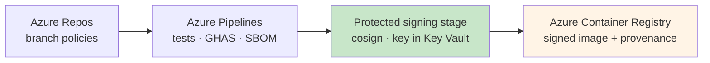
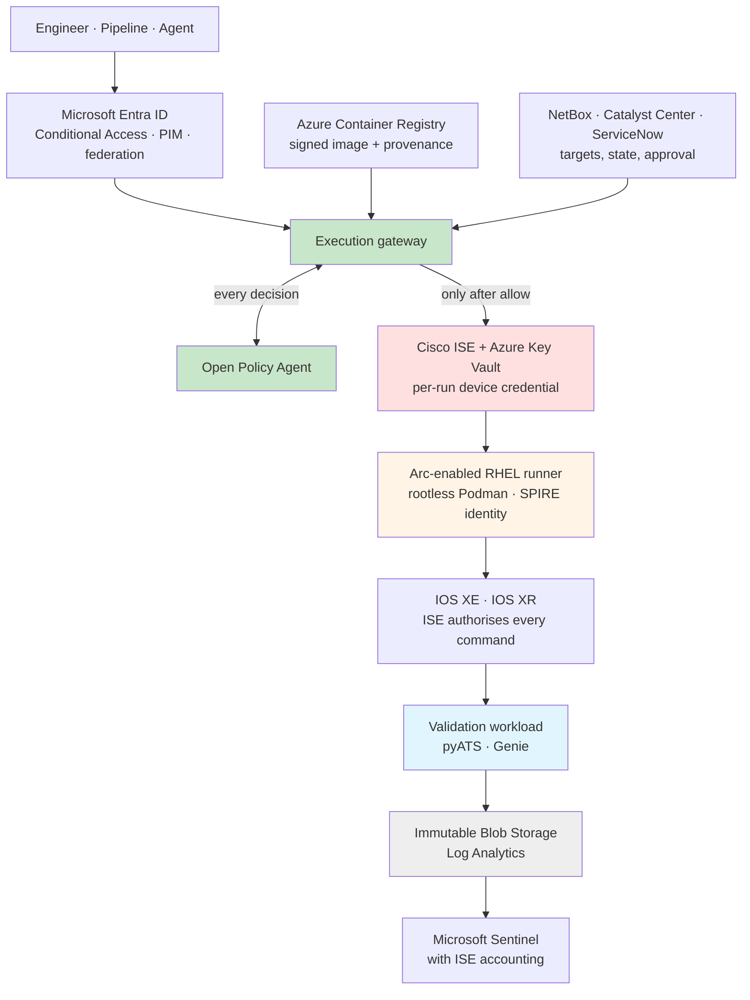

## Worked Example: Azure and Cisco

The rest of this section names responsibilities, not products. This page does the opposite, once. It takes one common stack and shows what Trusted Automation Execution looks like on it at full adoption, with every component of the [reference architecture](./architecture.md) in place:

- **Microsoft Entra ID and Azure** for identity, secrets, build, hosting, and evidence
- **NetBox and Cisco Catalyst Center** for target context
- **Cisco ISE, IOS XE, and IOS XR** on the network side

Two things are worth looking for as you read. The first is how much of the architecture existing products already provide. The second, and more useful, is where they stop: the places where no product on the list does the job, and you have to build or configure something deliberately.

!!! note "Illustrative, not a deployment"
    This describes no real organisation's environment. It is one possible mapping, chosen because these products are common in enterprise networks, and every component lists alternatives. Topology, naming, and policy values are deliberately absent: they are yours to decide, and they are the parts that would make a design like this sensitive. Like the [proof of concept](./proof-of-concept.md), this is a design. No code, templates, or configuration are published with it.

    Product names are trademarks of their respective owners, as acknowledged in the [Terms of Use](../../../legal/terms-of-use.md#trademarks). Naming them here is descriptive and implies no affiliation with, or endorsement by, any vendor.

---

## The Stack at a Glance

| Responsibility | In this example | Alternatives |
|---|---|---|
| **Human identity** | Microsoft Entra ID, with Conditional Access and Privileged Identity Management (PIM) | Okta, Ping Identity |
| **Workload identity** | SPIFFE identities issued by SPIRE on each runner, federated into Entra ID; workload identity federation for Azure Pipelines | Entra managed identities, where one identity per host is acceptable |
| **Source and review** | Azure Repos with branch policies | GitHub, GitLab |
| **Build and scanning** | Azure Pipelines on ephemeral agents, with GitHub Advanced Security for Azure DevOps | GitHub Actions, GitLab CI |
| **Artefact store** | Azure Container Registry (ACR) | Harbor, JFrog Artifactory |
| **Signing and provenance** | cosign, with signing keys held in Azure Key Vault; signed provenance and an SBOM attached to each image | Notation; GitHub artifact attestations |
| **Execution gateway** | A purpose-built service — the [proof of concept](./proof-of-concept.md)'s runner, grown up | Ansible Automation Platform or AWX as the orchestration layer *behind* it |
| **Policy decision** | Open Policy Agent (OPA) | Cedar |
| **Approval and change** | ServiceNow change management; Azure Pipelines environment approvals for pipeline-initiated work | Jira Service Management |
| **Source of truth** | NetBox | Nautobot, Infrahub |
| **Controller context** | Cisco Catalyst Center | Your controller or management platform |
| **Secrets** | Azure Key Vault | HashiCorp Vault, CyberArk |
| **Device authority** | Cisco Identity Services Engine (ISE), TACACS+ device administration | Aruba ClearPass, tac_plus-ng |
| **Runner** | Azure Arc-enabled RHEL, running each job in a fresh rootless Podman container | Any hardened Linux host |
| **Runner posture** | Azure Policy machine configuration, Microsoft Defender for Servers | Your configuration management and EDR |
| **Validation** | pyATS and Genie; Catalyst Center Assurance | Batfish, for pre-change modelling |
| **Evidence** | Azure Blob Storage with locked immutability policies; Log Analytics | Any WORM-capable object store |
| **Detection and response** | Microsoft Sentinel | Splunk, Elastic |
| **Network monitoring** | SolarWinds | Your network monitoring system |
| **Targets** | Cisco IOS XE and IOS XR | — |

The one row with no product in it is the important one. **Nothing on this list is an execution gateway.** Ansible Automation Platform comes closest: it has role-based access, job templates, approval nodes, and an Azure Key Vault credential plugin. But verifying a signed artefact and asking an external policy engine before releasing credentials are still yours to add. Whatever you build or adopt, it is the most trusted component in the design, and it gets the strictest supply chain.

---

## How the Pieces Connect

Two paths, kept deliberately apart. The publication path produces something the gateway can verify:

The execution path consumes it, and nothing on it can start without the gateway's decision:

---

## Component by Component

The groups follow the [nine sentences](./index.md#the-model-in-nine-sentences), plus the tenth group from the [architecture](./architecture.md#10-keep-trust-withdrawable).

### 1. Prove who is asking

| Component | In this stack |
|---|---|
| **Requester identity** | Every human requester is an Entra ID user. Conditional Access requires phishing-resistant MFA and a compliant device for anyone who can request a privileged run. For R3 and above, the requester role is PIM-eligible rather than standing: activation is time-limited and requires a justification and a change reference. Azure Pipelines authenticates through workload identity federation service connections, with no stored secret. A governed agent has its own Entra identity, and never borrows a person's |
| **Workload identity** | SPIRE runs on every runner. It attests the node, then attests each workload container — for example, by its image digest — and issues it a short-lived SPIFFE identity. Each workload has its own Entra application with a federated identity credential that trusts the SPIRE issuer, scoped to that workload's SPIFFE ID. The workload exchanges its short-lived token for an Entra token, and no secret exists anywhere in the chain |

Why not use the runner's Azure Arc managed identity? Because it is one identity per machine. Every workload on the host would share it, and policy could no longer tell the audit workload from the change workload. That is the shared-service-account collapse again, one layer down. The Arc identity still has a job: it identifies the *runner*, for posture and telemetry.

One operational detail: Entra ID has to be able to fetch the SPIRE issuer's discovery document and public keys. Publish them somewhere Entra can reach. They are public keys; the signing keys never leave SPIRE.

### 2. Prove what will run

| Component | In this stack |
|---|---|
| **Artefact identity** | Every workload release is an OCI image in Azure Container Registry, always referenced by digest and never by tag. The workload manifest — name, version, risk class, capabilities, platforms — is part of the image and covered by its signature. Released images are locked in ACR so they cannot be overwritten or deleted |
| **Artefact signing** | cosign signs each image using a key held in Azure Key Vault, so the private key is never exported. Signing happens in a dedicated, protected pipeline stage, whose service connection the build stage cannot use. Verification happens twice: the gateway verifies the signature before it decides, and the runner verifies it again before it will start the container |

Verifying in two places is deliberate. The gateway's check is the decision. The runner's check means that a bug in the gateway, or someone starting a container directly on the runner, still cannot run an unsigned workload.

Where that second check lives needs care, because the formats are moving. Podman can enforce signatures itself, through a `sigstoreSigned` entry in its signature policy, but only for cosign's legacy signature format. Since cosign 3, the default is the newer Sigstore bundle format, attached through OCI referrers. As of October 2026, Podman cannot discover signatures in that format. Cosign can still write the legacy format, but the flag that does it is deprecated and due for removal in cosign 4.

The durable choice is to make the second check a `cosign verify` against the image digest in the runner's own launch step, before Podman is ever called. The same approach works if you standardise on Notation instead, which Podman's policy does not verify either. Move the check into Podman's policy once Podman reads the format you sign with.

### 3. Establish where it came from

| Component | In this stack |
|---|---|
| **Build provenance** | The pipeline records a provenance statement in the SLSA format — repository, commit, pipeline, and build parameters — which the protected stage signs and attaches to the image. The gateway verifies that the builder identity, source repository, and branch match what policy expects for that workload |
| **Dependency evidence** | Dependencies are locked with hashes. GitHub Advanced Security for Azure DevOps runs code scanning, dependency scanning, and secret scanning with push protection. An SBOM is generated at build time and attached to the image. Base images come from Red Hat's Universal Base Image, and Microsoft Defender for Containers scans the registry. Policy can refuse a workload with unresolved critical findings |

The honest gap is provenance. Azure Pipelines has no built-in equivalent of GitHub's artifact attestations, so here the provenance is asserted by your own pipeline. That can be made trustworthy, but only by isolation: ephemeral build agents, a signing stage the build cannot influence, and protected service connections. Do not claim a SLSA build level you have not actually assessed.

### 4. Decide what it may do

| Component | In this stack |
|---|---|
| **Execution gateway** | A purpose-built service on a hardened host, authenticating every caller against Entra ID. It is the only route that can start a privileged workload: runners accept work only from the gateway, over mutual TLS using SPIFFE identities. If Ansible Automation Platform is used for orchestration, it sits behind the gateway, and its own interface must not become a second way in |
| **Policy decision service** | Open Policy Agent. Policy lives in its own repository, is reviewed like code, and is published as signed bundles that OPA verifies on load. Every decision is logged with the bundle revision that made it — the `policy_version` from the [policy decision](./architecture.md#the-policy-decision) — and the decision logs go to Log Analytics |
| **Policy context** | Entra claims, including whether a PIM role is active. The workload manifest and its verification results. NetBox status, role, site, environment, and criticality. Catalyst Center management and compliance state. ServiceNow change state, window, and approver. Runner posture from machine configuration and Defender, queried rather than assumed. Any input older than a policy-set freshness limit counts as missing, and missing means deny |
| **Human approval** | A ServiceNow change request carries the artefact digest, capability, target set, and window. Small, reversible R3 changes use standard change templates, pre-approved for a specific workload version. OPA checks that the approver is not the requester, and that the digest in the change matches the digest being run. Pipeline-initiated work uses Azure Pipelines environment approvals and checks, including the ServiceNow change management check |

The ServiceNow record is useful twice. At stage 6 it is a policy input. At stage 9, re-reading it is [revalidation](../../production-grade-network-automation-principles/remediation-packs.md#revalidation-before-execution): an approval withdrawn in the meantime stops the run.

### 5. Constrain where it may do it

| Component | In this stack |
|---|---|
| **Authoritative source of truth** | NetBox resolves every target by its record, never by the name a caller typed. A workload can only resolve devices in an active status, in the roles and sites its policy grant allows. NetBox object permissions let the automation read the records that define its scope, but not edit them. Catalyst Center is the second identity source (controller-held), and the live device is the third, at pre-flight |
| **Network and target enforcement** | ISE gives each workload capability its own TACACS+ identity, mapped to a shell profile and a command set containing exactly the commands that workload uses. Device administration policy limits which network device groups each identity can log in to at all. Devices accept management sessions only from the runner network — VTY access classes on IOS XE, Management Plane Protection on IOS XR — ideally in a management VRF. Runner egress is deny-by-default, open only to target management ranges and to private endpoints for Key Vault, ACR, and Log Analytics |

Two details in this group are easy to get wrong.

**Read-only access to the source of truth matters.** A workload that can edit NetBox can widen its own scope, by moving a device into a role it is allowed to touch.

**Command sets govern the CLI only.** NETCONF and RESTCONF sessions are not checked against TACACS+ command sets. Model-driven access needs its own rules, through the NETCONF Access Control Model, and task groups on IOS XR. A design that restricts the CLI carefully, then gives the same identity unrestricted NETCONF, has restricted nothing.

### 6. Grant only the authority required

| Component | In this stack |
|---|---|
| **Just-in-time, scoped privilege** | At stage 7, the gateway generates a fresh random password for the workload's ISE identity, sets it through the ISE API, enables the identity, and writes the password to Key Vault as a new secret version with an expiry. At stage 12 it disables the identity and rotates the password again. Between runs, no working device credential exists for that workload. Entra tokens for Azure resources are short-lived by design |
| **Secrets handling** | Key Vault access is granted per secret: each workload's Entra identity can read its own device credential, and its own read-only NetBox and Catalyst Center API tokens, and nothing else. Key Vault is reachable only through a private endpoint, and every secret read is logged to Log Analytics. No secret lives in pipeline variables, images, or runner configuration |

This group holds the limit of the whole design. **Network devices cannot accept short-lived tokens.** TACACS+ authenticates a username and a password, so the best available pattern is a password that only works during the run: rotated per run, narrowed by command sets, and bound to device groups.

In ISE that rotation is an ordinary update to the internal user, through the ERS API. That means a PUT, or a PATCH from ISE 3.2, carrying the new password and the enabled flag. Writes go to the primary administration node, which replicates them to the policy service nodes that answer TACACS+, so allow for replication before the workload connects. Rotating the password in the same update that disables the account also avoids ISE's password history rejecting a re-sent old password.

Two failure cases need a deliberate answer:

- **The ISE update fails.** The run fails safe and does not start. It never falls back to a standing credential.
- **Stage 12 never happens,** because the gateway dies mid-run. A scheduled sweep disables any automation identity that is enabled without an active run, so the credential cannot outlive the gateway for long.

### 7. Execute within defined boundaries

| Component | In this stack |
|---|---|
| **Isolated, ephemeral runner** | Azure Arc-enabled RHEL hosts with SELinux enforcing. Azure Policy machine configuration enforces and reports the hardened baseline, Defender for Servers provides endpoint detection, and Azure Update Manager handles patching. Each run is a fresh rootless Podman container, started from the verified digest, with a read-only root filesystem, every capability dropped, no host mounts, and removal when the run ends. Hosts are rebuilt from a golden image on a short cycle rather than patched indefinitely |
| **Pre-flight validation** | Three-source identity: the NetBox record, Catalyst Center's inventory, and the live device must agree. Then platform and software version, the running image against expected values, health, drift from the last approved configuration, and — read again from ServiceNow — an approval that is still valid and a window that is still open |
| **Execution safeguards** | Canary first, then batches sized by risk class, with concurrency limits, per-device timeouts, and a circuit breaker on failure rate. Changes use the device's own confirmed-commit mechanism. On IOS XR that is `commit confirmed`. On IOS XE it is either the Configuration Rollback Confirmed Change feature — a timed change that reverts unless `configure confirm` arrives in time, and which needs a configuration archive — or a NETCONF confirmed commit against the candidate datastore. RESTCONF has no confirmed commit, so changes that must be able to revert themselves go over NETCONF or the CLI. The change is confirmed only after independent validation passes |

The confirmed commit is the safeguard that survives the automation failing. If the runner, the gateway, or the network between them disappears mid-change, the device reverts on its own when the timer runs out. Every other safeguard on this page depends on something staying up. This one does not.

It still has to be tested, because the revert is only as good as the platform's implementation of it. Cisco's own IOS XE guides note cases where a revert can miss part of a configuration. Exercise a deliberate timeout on each platform and software release you automate, and treat a revert that does not restore the original state as a reason to keep that platform at a lower risk class until it does.

### 8. Validate the resulting state independently

| Component | In this stack |
|---|---|
| **Independent post-execution validation** | A separate validation workload, with its own image, its own SPIFFE identity, and its own read-only ISE identity, runs pyATS and Genie against each changed device. It diffs the learned state against the pre-change snapshot and against the expected state recorded in the [remediation pack](../../production-grade-network-automation-principles/remediation-packs.md). Catalyst Center Assurance health is a second signal, and SolarWinds alerting a third. The gateway tells the change workload to confirm only on a pass. On a failure, or no answer, the device reverts by itself |

The validator never borrows the change workload's identity or code. That is what makes it independent rather than a second opinion from the same author.

### 9. Prove what happened

| Component | In this stack |
|---|---|
| **Evidence and audit record** | The gateway assembles the full [evidence record](./architecture.md#the-evidence-record) for every run, including denied ones, and writes it to Log Analytics and to a Blob Storage container under a locked, time-based immutability policy. The run ID is written into the ServiceNow change as well |
| **Tamper-resistant central evidence** | The workload cannot reach the evidence store at all. And ISE's TACACS+ accounting gives a second, device-side record of every command each workload identity ran, forwarded to Sentinel — a record that never passes through the workload |
| **Telemetry, detection, and response** | Microsoft Sentinel raises incidents for policy denials, break-glass use, Key Vault reads outside a run, runs outside change windows, runners drifting from baseline, and any TACACS+ session by a workload identity when no run is active. Responses are Sentinel automation rules and playbooks. NTP keeps the runners, ISE, and devices on one clock, because correlation across three logs fails without it |

The last detection is the one to build first. With per-run credential rotation, a workload identity logging in to a device outside a run should be impossible. So any occurrence is an incident, not noise.

### 10. Keep trust withdrawable

Revocation works at several layers. Any one of them is enough to stop a run, and each is fast:

| To withdraw | Act here | Effect |
|---|---|---|
| One workload version | A digest deny-list in OPA's policy data | The gateway refuses that version immediately |
| A whole workload | Disable its Entra application, or its federated credential, and its ISE identity | It can no longer obtain secrets or log in to a device |
| A publisher or signing key | Disable the key version in Key Vault, and remove it from the keys policy trusts | Nothing signed with it is accepted |
| A requester | Remove their PIM eligibility, or disable the account | They can no longer start privileged runs |
| A runner | Remove its SPIRE registration, and block it at the network | No workload on it can obtain an identity |
| Everything | A global deny in OPA, and disable the ISE identity group for automation | All privileged automation stops, at the gateway and at the devices |

Break-glass is designed in three places:

- **Identity:** Entra emergency access accounts, managed as Microsoft's guidance describes, with an alert on every sign-in. They exist for the day Entra-dependent controls lock everyone out.
- **Devices:** the `local` method in a device's AAA configuration *is* the device break-glass route. IOS falls back to it only when the TACACS+ servers do not respond, not when they refuse. Each device has a unique local account, held in a separate Key Vault behind PIM, rotated after every use. Every local login raises a Sentinel incident.
- **Automation:** a separate gateway path for emergency workloads, with its own identity, a stated reason, and narrowed scope. Artefact verification is never skipped. The ServiceNow emergency change is raised immediately, and every use is reviewed afterwards.

Governance ties it together. Each workload is registered as a service with its owners and risk class, as in the [Automation Service Lifecycle](../../production-grade-network-automation-principles/automation-service-lifecycle.md). Entra access reviews recertify the requester groups and PIM eligibility. ISE command sets are reviewed against the accounting data, which shows exactly which permitted commands a workload has never used.

---

## One Run, End to End

An R3 change to a batch of IOS XE access switches, requested by an engineer, through the fourteen stages of the [execution lifecycle](./architecture.md#the-execution-lifecycle):

| Stage | In this stack |
|---|---|
| **1. Request** | The engineer activates their PIM role, quoting the change number, and submits a request to the gateway naming the workload release by digest and the target set |
| **2. Authenticate the requester** | The gateway validates the Entra token: Conditional Access satisfied, PIM role active, group membership current |
| **3. Resolve the workload** | The gateway reads the workload manifest from the image's signed metadata in ACR |
| **4. Verify the supply chain** | Signature, provenance, builder identity, and scan results are verified against what policy expects for that workload |
| **5. Resolve targets** | NetBox resolves the target set to records; Catalyst Center confirms each device is managed and compliant |
| **6. Evaluate policy** | OPA evaluates the requester, workload, capability, targets, change record, approver separation, runner posture, and freshness. The decision and the bundle revision are logged |
| **7. Acquire privilege** | The gateway rotates and enables the workload's ISE identity, and writes the new credential to Key Vault with an expiry |
| **8. Prepare the runner** | A fresh rootless Podman container starts from the verified digest. SPIRE attests it and issues its identity, which it exchanges for an Entra token to read its credential |
| **9. Pre-flight** | Three-source identity, health, drift, and a re-read of the ServiceNow change. A device that fails is excluded and recorded, not forced |
| **10. Execute safely** | Canary device first, then batches, each change applied with a revert timer running |
| **11. Validate independently** | The validation workload runs pyATS against each device. On a pass, the gateway tells the change workload to confirm; on a failure, the timer reverts the device and the circuit breaker halts the batch |
| **12. Close authority** | The gateway disables and rotates the ISE identity. The container is removed |
| **13. Preserve evidence** | The full record goes to immutable Blob Storage and Log Analytics, and the run ID to the ServiceNow change |
| **14. Observe and respond** | Sentinel correlates the gateway record, Key Vault reads, and ISE accounting for the run, and stays quiet only if all three agree |

---

## What This Reaches, and What It Does Not

With everything above in place, this stack implements the **Enterprise** profile in full, and most of **High-Assurance**. Five things stand between it and the rest, and a design review should hear about them from you before it finds them itself:

1. **Device authority is still a password.** Rotated per run, narrowed by command sets, bounded by device groups — but not a capability-scoped token. That is a limit of TACACS+ and of the devices, not of the design.
2. **Provenance is self-asserted.** Your pipeline vouches for your build. Isolation makes that credible, but it is not the guarantee a hardened, hosted build platform provides.
3. **Runner posture is reported, not hardware-rooted.** Arc, machine configuration, and Defender report the runner's state. For High-Assurance, add TPM-based node attestation, which SPIRE supports, so that a runner's identity depends on its measured boot state.
4. **The most trusted component is bespoke.** The gateway and the OPA policies are your own code. They get the strictest supply chain on the page: the same signing, provenance, and separation of duties, applied first and hardest.
5. **Availability is a dependency chain.** Entra ID, Key Vault, ISE, ServiceNow, NetBox, and OPA all have to be up for privileged automation to run. That is the [fail-closed cost](./threat-and-failure-model.md#fail-closed-and-what-it-costs), paid deliberately. Engineer each dependency for the availability you need, and exercise the break-glass routes before you need them.

None of these is a reason to stop short. Each is a known, stated residual risk, which is what a reference architecture is supposed to leave you with.

---

## Continue

- Previous: [Adoption Profiles](./adoption-profiles.md)
- Next: [Proof of Concept v1](./proof-of-concept.md)
- Section index: [Trusted Automation Execution](./index.md)
