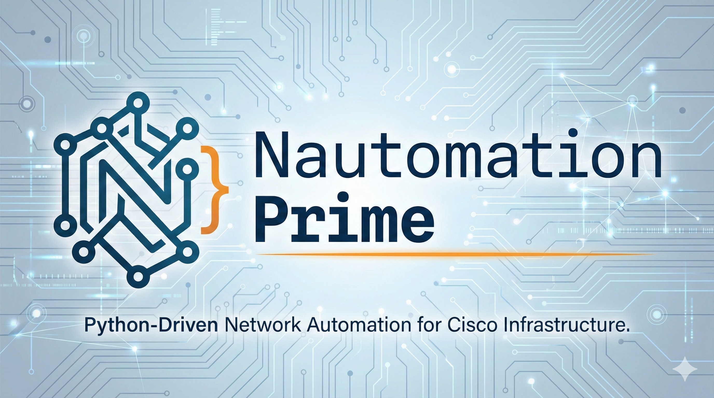

---

Transparent Cisco automation for teams that need ownership, not black boxes

## Advanced Cisco network automation your team can actually own

I'm Christopher Davies, a Cisco network automation engineer. Nautomation Prime is where I publish how I build transparent, production-grade Cisco automation: free tutorials, standards and deep dives, with every system explained and every design decision documented. I'm also available for contract work.

[Explore the Academy](./academy/index.md){.md-button .md-button--primary}
[Available for Contract Work](./work-with-me/index.md){.md-button}
[Build netpipe: the Capstone](./foundation/tutorials/capstone/index.md){.md-button}
[Meet Christopher Davies](./founder.md){.md-button}

<ul class="np-signal-list">
  <li>Enterprise Cisco focus</li>
  <li>No black-box automation</li>
  <li>Open to remote and hybrid contracts</li>
</ul>

> **Transparency note:** Nautomation Prime is a one-person, founder-led practice. The work examples on this site come from my employed roles. Where a figure is an illustrative estimate rather than a measured result, it is labelled as one.

---

## Why network automation efforts stall

-   ### The code works, but nobody owns it

    Many automation projects fail after delivery because the team inherits a black box they cannot safely change.

    [See the transparency model](./prime-framework/philosophy.md)

-   ### The wrong tasks get automated

    Busy work gets scripted while higher-value operational bottlenecks and risk reduction are ignored.

    [See how I prioritise work](./prime-framework/pinpoint.md)

-   ### Leadership cannot see the ROI

    Without measurable outcomes, automation stays tactical instead of becoming an investable programme.

    [Review the measurement approach](./prime-framework/measure.md)

---

## Learn, build, or work with me

-   ### Learn

    Build practical Cisco automation capability, free, through the Nautomation Prime Academy: tutorials, the netpipe Capstone, deep dives, and production-grade engineering guidance.

    [Go to the Academy](./academy/index.md) · [Build netpipe](./foundation/tutorials/capstone/index.md)

-   ### Build

    See the code: hardened scripts, implementation patterns, and public repositories that show how I structure production automation.

    [Explore the script library](./scripts/index.md) · [GitHub](https://github.com/Nautomation-Prime)

-   ### Work with me

    Hire me on contract for Cisco network automation or senior network engineering, fully remote or hybrid. Small fixed-scope projects are available by enquiry.

    [Work with me](./work-with-me/index.md)

---

### Looking for a Cisco network automation contractor?

I'm available for contract roles, fully remote or hybrid within reach of Leek, Staffordshire. Everything on this site shows how I work before you ever speak to me.

[Work With Me](./work-with-me/index.md){.md-button .md-button--primary}
[Download My CV (PDF)](./assets/cv/Christopher_Davies_CV.pdf){.md-button}
[Connect on LinkedIn](https://www.linkedin.com/in/christopher-davies-6b345026/){.md-button}

---

## Selected work from my career

Projects from my employed roles in enterprise networking, as they appear on my CV.

-   ### Zero-touch provisioning in production

    A Python ZTP workflow on RHEL and AWX for a multi-site UK manufacturer, with site-aware logic, serial-number-based configuration mapping and fallback templates.

-   ### A national switch rollout, automated

    Python automation for large-scale switch configuration during a nationwide upgrade across UK courts, prisons and probation offices.

-   ### Multi-site upgrades and wireless redesign

    Upgrade plans for multiple UK manufacturing sites, and site-wide wireless redesigns validated with Ekahau AI Pro and Sidekick.

-   ### NHS collaboration integration

    A solution integrating Cisco networking, Dell virtualisation hosts and Pexip across the NHS HSCN network.

[See how I work →](./work-with-me/index.md) | [Read the production-grade principles →](./foundation/production-grade-network-automation-principles/index.md)

---

## No black-box automation

-   ### Every system explained

    Tutorials, deep dives, and the automation I build are written for comprehension, not mystique.

-   ### Every design decision documented

    Logging, runbooks, validation strategy, and design rationale are treated as part of the deliverable.

-   ### Everything I build is handed over

    Whether on contract or on a project, the goal is to leave your team with capability, not dependency.

---

### Built by Christopher Davies

Christopher Davies is a network engineer with 10+ years in enterprise infrastructure and automation, currently working towards CCNP Enterprise and CCNP Automation. His background spans large-scale Cisco delivery, critical infrastructure environments, and production automation that has to survive real-world operational constraints.

  

    <strong>10+ years</strong>
    Enterprise network engineering and automation delivery
  

  

    <strong>CCNP in progress</strong>
    Working towards Enterprise and Automation
  

  

    <strong>Production focus</strong>
    Upgrades, audits, compliance, and capability transfer across live estates
  

  <a href="./founder.md">Read Christopher's story</a>
  <a href="./work-with-me/index.md">Work with me</a>
  <a href="./assets/cv/Christopher_Davies_CV.pdf">Download CV (PDF)</a>

---

## Hiring, or just learning?

If you're recruiting for a Cisco automation or network engineering contract, I'd like to hear about it. If you're here to learn, everything in the Academy is free.

[Contract Role Enquiry](mailto:enquiries@nautomationprime.io?subject=Contract%20Role%20Enquiry){.md-button .md-button--primary}
[Start Here](./start-here.md){.md-button}
[Small Projects by Enquiry](./smb/index.md){.md-button}

---

## Beyond paid work

The **[Nautomation Prime Academy](./academy/index.md)** offers free network automation education to anyone, and the **[Nautomation Prime Foundation](./foundation/index.md)** sets out free or low-cost Cisco and general networking engineering, infrastructure advice, and automation help for registered UK charities and CICs, scheduled around contract commitments.

[Explore the Academy →](./academy/index.md) | [Explore the Foundation →](./foundation/index.md)

---

Between the Lines

A pot of tea brewed properly takes longer than a coffee pulled through a machine, and it stays interesting for eight infusions instead of one.

Good automation works on the same principle: speed was never really the point. It was always about buying back a few hours nobody would have got back otherwise. What you do with them is the part I don't automate.

